# Arquitectura del Ecosistema CRM RAI Agency

**Generador de Imágenes · Automatización de Marketing · Contenido Multimedia · Sitios Web**

| Campo | Valor |
|---|---|
| Documento | `docs/ARQUITECTURA-ECOSISTEMA-CRM.md` |
| Versión | 1.0 |
| Fecha | 17 oct 2026 |
| Autor | Claude (rol: Arquitecto de Software Principal, Ingeniero Full-Stack y Experto UX/UI), por encargo de Reiner |
| Rama de trabajo | `rai-feat-dashboard-premium` (commits locales; sin push) |
| Alcance | Arquitectura, refactorización, estrategia de integración y hoja de ruta de los cuatro módulos |
| Fuente de verdad del backlog | `docs/planning/panel-control.html`; el avance de este documento se registra en `docs/planning/roadmap-agentes-rai.html` (fase 11) |
| Estado de las decisiones | Cada ADR indica si está **Aceptada** (ya implementada o coherente con decisiones previas de Reiner) o **Propuesta** (requiere aprobación explícita antes de implementarse) |

---

## Tabla de contenidos

0. Resumen ejecutivo y estado real del sistema
1. Visión del ecosistema, sinergias, patrones y contratos de API
2. Clean Code, estado, errores, TypeScript estricto y deuda técnica cero
3. Arquitectura y UX por módulo
   - 3.1 Generador de Imágenes
   - 3.2 Automatización de Marketing
   - 3.3 Contenido Multimedia
   - 3.4 Sitios Web
4. Hoja de ruta de implementación en cuatro fases y KPIs
5. Registro de decisiones (ADR)
6. Anexos: glosario, convenciones de nombres, checklist de revisión

---

## 0. Resumen ejecutivo y estado real del sistema

### 0.1 Propósito

Este documento define **cómo deben evolucionar cuatro módulos del CRM para comportarse como un solo producto**: una persona genera una imagen, la encuentra sin buscar en la biblioteca, la programa con una automatización y la ve publicada en su sitio web, sin cambiar de contexto mental ni repetir datos. Cada decisión de backend se justifica por el beneficio que produce en la experiencia de la persona usuaria; si una decisión técnica no tiene beneficio de experiencia o de operación demostrable, no entra.

### 0.2 Qué existe hoy (verificado en el repositorio, HEAD `bde9466`)

| Módulo | Ruta | Estado real | Piezas clave |
|---|---|---|---|
| Generador de Imágenes | `/generador-imagenes` | **Mejorado en Ola 3** (commit `9938a33`): asistente de 5 nodos, historial, plantillas, calidad, exportación | `ContentGrid`, `ContentGridAsset`; `POST /api/content-grids/[id]/generate-image` (síncrono, `maxDuration = 120`); `visual-agent.ts` (Gemini / OpenAI / Stability); `ingestUrl` a R2; `grid-*.ts` en `src/lib` |
| Automatización de Marketing | `/automatizacion` | **Mejorado en Ola 3b** (commit `a481ecd`): editor dividido, 19 plantillas, actividad en servidor, exportación CSV | `Workflow`, `WorkflowFolder`, `WorkflowRun`; motor en `src/lib/automations/` (`engine.ts`, `actions.ts`, `conditions.ts`, `types.ts`); `POST /api/automations/run-due` |
| Contenido Multimedia | `/contenido-multimedia` | **Agregador de solo lectura** (commit `0f62089`): une imágenes del Generador, salidas de campañas y medios de publicaciones programadas; **sin subida libre** | `GET /api/media` (caché de 20 s); `media-*.ts`; decisión de almacenamiento abierta en `docs/DECISION-ALMACENAMIENTO-MULTIMEDIA.md` |
| Sitios Web | `/sitios` | **Aún no es un constructor de sitios.** Hoy es un registro de propiedades físicas (hotel, restaurante, oficina, local) con habitaciones, reservas y pagos | Modelo `Site` (tipo, dirección, capacidad, estado); `Room`, `RoomType`, `Booking`, `Payment`; `GET/POST /api/sites`; `/api/public/booking` |

> **Hallazgo crítico para el diseño.** El módulo «Sitios Web» del encargo describe un constructor visual de páginas (editor WYSIWYG, tokens CSS, SSG/SSR, edición responsive, deshacer/rehacer). El código actual de `/sitios` no hace nada de eso: administra *propiedades* (sedes). Este documento resuelve la ambigüedad así: la entidad actual se mantiene intacta y se nombra en la interfaz como **Sedes** (propiedades físicas), y el constructor es un **nuevo contexto delimitado** llamado `web` con modelos propios (`WebProject`, `WebPage`, `WebPageVersion`, `WebDomain`). Ningún modelo existente se renombra ni se rompe. Ver ADR-004.

### 0.3 Infraestructura transversal ya disponible (se reutiliza, no se reinventa)

| Capacidad | Dónde vive hoy | Uso en esta arquitectura |
|---|---|---|
| Cola y workers | `bullmq` 5.20 + `ioredis` 5.4; cola `content-pipeline` en `src/lib/redis.ts`; worker `src/workers/pipeline-worker.ts` (`npm run worker`) | Base de la cola de generación de imágenes y del motor de reintentos de automatizaciones |
| Progreso en tiempo real | SSE en `src/app/api/events/[campaignId]/route.ts` (`maxDuration = 300`) con suscriptor Redis | Se estandariza como canal único de progreso de trabajos (§1.5.5) |
| Almacenamiento de objetos | `src/lib/r2.ts` con `@aws-sdk/client-s3` y `s3-request-presigner`: `uploadAsset`, `ingestUrl`, `getDownloadUrl` | Almacén único de binarios para los cuatro módulos |
| Caché de lectura en cliente | `swr-cache.ts`, `use-cached-json.ts`, `route-data.ts` (prefetch al pasar el cursor) | Capa estándar de estado de servidor en cliente |
| Caché en servidor | `ttl-cache.ts` (`TtlCache<T>`), `role-context-cache.ts` | Lecturas costosas (resumen, listados) |
| Seguridad y permisos | `requireRole`, `CONTENT_GENERATOR_WRITE_ROLES`, `isRoleContext` en `src/lib/roles.ts`; `rate-limit.ts`; BYOK cifrado (AES-256-GCM, modelo `ApiKey`) | Se aplica a todo endpoint nuevo |
| Auditoría | `src/lib/audit.ts` → `logAudit`; modelo `AuditEvent` | Registro obligatorio de acciones de escritura |
| Idempotencia y reintentos | `ScheduledPost` (`@@unique([workspaceId, campaignRef, dayNumber])`, `igContainerId` guardado antes de publicar, `MAX_ATTEMPTS = 3`, `STALE_LOCK_MS`), `publish-runner.ts` con dependencias inyectadas (`RunnerDeps`) | Patrón de referencia para todos los ejecutores asíncronos |
| Sistema de diseño | `src/styles/effects.css` (`fx-*`), `Skeleton`, `EmptyState`, `PageSkeleton`, `ClickFx`, `DensityToggle`; tokens `var(--rai-*)`; registro en `docs/DISENO-EFECTOS.md` | Base visual compartida; ninguna pantalla nueva define su propio estilo de carga o vacío |
| Validación | `zod` 3.23 | Contratos de entrada/salida |
| Pruebas | `vitest` 5 (848 pruebas en 94 archivos al HEAD), `playwright` (e2e), CI en `.github/workflows/ci.yml` | Puertas de calidad (§2.5) |

### 0.4 Reglas innegociables (heredadas de decisiones previas de Reiner)

1. **Sin efectos de desenfoque (blur).** Animaciones solo con `transform` y `opacity`, 150–250 ms, `ease-out`, bajo `prefers-reduced-motion: no-preference`; hover bajo `(hover:hover)`.
2. **Responsive al 100 %** de 320 px a 1440 px; sin dos contenedores con scroll anidados.
3. **Efectos informativos, no saturantes**; premium pero sutil.
4. **Sin cambios de esquema Prisma ni migraciones sin aprobación explícita de Reiner.** Todo modelo nuevo de este documento está marcado como *Propuesta*.
5. **Sin push, merge, cambios de producción, `IG_PUBLISH_MODE=live`, telefonía real ni pagos reales** sin autorización explícita.
6. **Nunca imprimir valores de `.env*`**; solo nombres de variables.
7. **Ortografía impecable** y nombre de la persona dueña del proyecto: **Reiner**.

### 0.5 Convenciones de este documento

- Los diagramas están en **Mermaid**; los contratos en bloques `typescript`, `json` o `yaml`.
- «Propuesta» significa que el elemento **no existe** en el repositorio y necesita aprobación; «Existente» significa que se verificó en el código.
- Las métricas objetivo (KPIs) son metas de aceptación, no mediciones ya realizadas. Las mediciones reales de producción **aún no se han tomado**; la fase 4 incluye cómo obtenerlas (§4.5).

---

## 1. Visión del ecosistema

### 1.1 Mapa de contexto del sistema

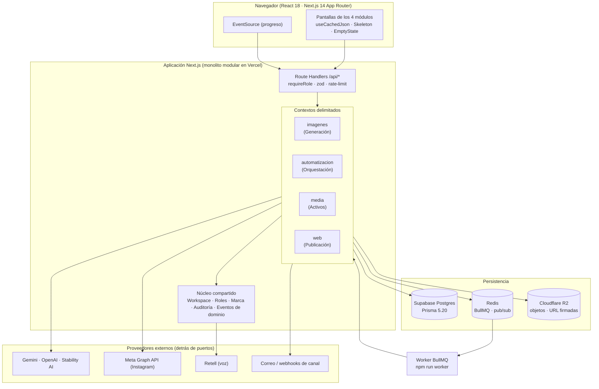

### 1.2 Contextos delimitados y mapa de relaciones

Cada módulo es un **contexto delimitado** con su propio lenguaje, sus propias tablas y una API pública explícita. La relación entre contextos sigue tres reglas: el **núcleo compartido** solo contiene lo que *de verdad* comparten los cuatro; los contextos se hablan mediante **eventos de dominio** (asíncrono) o **interfaces públicas** (síncrono, solo lectura); y ningún contexto lee las tablas de otro.

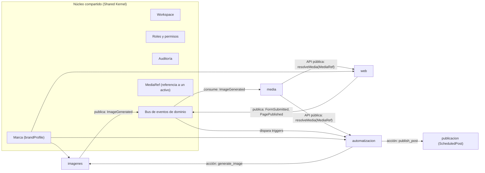

| Contexto | Responsabilidad única | Tablas propias (existentes → **Propuesta**) | Publica eventos | Consume eventos |
|---|---|---|---|---|
| `imagenes` | Convertir una intención creativa en imágenes con costo, calidad y trazabilidad | `ContentGrid`, `ContentGridAsset` → **`ImageJob`** | `ImageJobQueued`, `ImageJobProgressed`, `ImageGenerated`, `ImageJobFailed` | `BrandProfileUpdated` |
| `automatizacion` | Reaccionar a eventos con flujos auditables e idempotentes | `Workflow`, `WorkflowFolder`, `WorkflowRun` → **`WorkflowRunStep`**, **`OutboxEvent`** | `WorkflowRunStarted`, `WorkflowRunFinished`, `WorkflowRunFailed` | todos los eventos de dominio que sean *triggers* |
| `media` | Ser el inventario único y consultable de activos | (agregador) → **`MediaAsset`**, **`MediaVariant`**, **`MediaTag`** | `MediaAdded`, `MediaTagged`, `MediaDeleted` | `ImageGenerated`, `PagePublished` |
| `web` | Diseñar, versionar y publicar páginas | `Site` (sede, sin cambios) → **`WebProject`**, **`WebPage`**, **`WebPageVersion`**, **`WebDomain`** | `PageDraftSaved`, `PagePublished`, `FormSubmitted` | `MediaDeleted`, `BrandProfileUpdated` |

### 1.3 Sinergias entre módulos (cada una con su beneficio de experiencia)

| # | Flujo | Cómo funciona | Beneficio para la persona usuaria |
|---|---|---|---|
| S1 | Generador → Multimedia | Al terminar una imagen, `imagenes` publica `ImageGenerated`; `media` crea el `MediaAsset` de forma idempotente (clave = `r2Key`) | La imagen aparece en la biblioteca sin acción manual y sin duplicados |
| S2 | Multimedia → Sitios Web | El editor abre el *selector de medios* (misma pieza de interfaz que la biblioteca, en modo selección) y guarda un `MediaRef`, no una URL | Cambiar o borrar una imagen en la biblioteca actualiza o avisa en todas las páginas que la usan |
| S3 | Marca → los tres creativos | `brandProfile` del `Workspace` se traduce a *design tokens* (colores, tipografías, tono) que consumen el Generador (prompt), el editor web (CSS) y las plantillas de automatización (mensajes) | Una sola fuente de identidad; cambiarla una vez la propaga |
| S4 | Automatización ← Generador | Nuevo *trigger* `grid.completed` y nueva acción `schedule_grid_posts` | «Cuando termine esta grilla, prográmala en Instagram a las 9:00» sin salir del editor de flujos |
| S5 | Automatización ← Sitios Web | Nuevo *trigger* `web.form_submitted` que crea el contacto y dispara el flujo de bienvenida | Un formulario del sitio se convierte en un contacto atendido en segundos |
| S6 | Automatización → Generador | Nueva acción `generate_image` con límite de costo por ejecución | Campañas recurrentes generan su arte solas, dentro de un tope |
| S7 | Sitios Web → Multimedia | Al publicar, las imágenes usadas se registran como *uso* (`MediaUsage`) del activo | Antes de borrar una imagen se ve dónde está en uso |
| S8 | Generador → Sitios Web | Botón «Usar en una página» en cada imagen del historial: crea un `MediaRef` y abre el editor con la imagen insertada | Del resultado creativo a la página en dos clics |

> **Regla de integración.** Toda sinergia pasa por un **evento de dominio** o por una **interfaz pública de lectura**. Si una sinergia exige que un módulo importe un archivo interno de otro, la sinergia está mal diseñada y se rediseña (ver regla de dependencias, §1.4.2).

### 1.4 Patrones arquitectónicos

#### 1.4.1 Decisión: monolito modular orientado a eventos (ADR-001, **Aceptada**)

Se mantiene un **único despliegue Next.js** (Vercel) con un worker BullMQ aparte, organizado como **monolito modular** con fronteras de contexto impuestas por lint. No se adoptan microservicios.

| Criterio | Monolito modular (elegido) | Microservicios (descartado) |
|---|---|---|
| Equipo | Un desarrollador principal con agentes asistentes | Exige equipos por servicio |
| Despliegue | Vercel serverless + un worker; ya funciona | Orquestación, redes, versionado entre servicios |
| Transacciones | Una base de datos; transacciones ACID entre tablas del mismo contexto | Sagas distribuidas desde el día 1 |
| Costo operativo | Bajo; encaja con los planes de 34/49/67 USD del producto | Alto y fijo |
| Evolución | Cada contexto puede extraerse luego porque solo habla por eventos e interfaces | Sin ventaja hoy |

**Criterio de extracción futura** (cuando se cumpla *alguno*): el worker de un contexto necesita escalar de forma independiente durante más de 30 días seguidos, o un contexto requiere un ciclo de despliegue distinto al del resto.

#### 1.4.2 Estructura de carpetas y regla de dependencias (Propuesta de organización; migración incremental)

```yaml
src/
  app/                       # Capa de presentación y rutas (Next.js App Router)
    generador-imagenes/      # solo UI + hooks; sin lógica de negocio
    automatizacion/
    contenido-multimedia/
    sitios/                  # sedes (propiedades) — sin cambios
    web/                     # NUEVO: constructor de sitios (rutas /web/*)
    api/                     # Route Handlers: validan, autorizan y delegan
  modules/                   # NUEVO: dominio por contexto (sin React)
    imagenes/
      domain/                # entidades, value objects, reglas puras
      application/           # casos de uso (servicios) y puertos (interfaces)
      infrastructure/        # adaptadores: Prisma, BullMQ, R2, proveedores de IA
      index.ts               # API pública del contexto (único punto de entrada)
    automatizacion/
    media/
    web/
  kernel/                    # NUEVO: núcleo compartido (marca, eventos, errores, logger)
  lib/                       # utilidades existentes (se migran por oleadas)
  styles/                    # effects.css y tokens
```

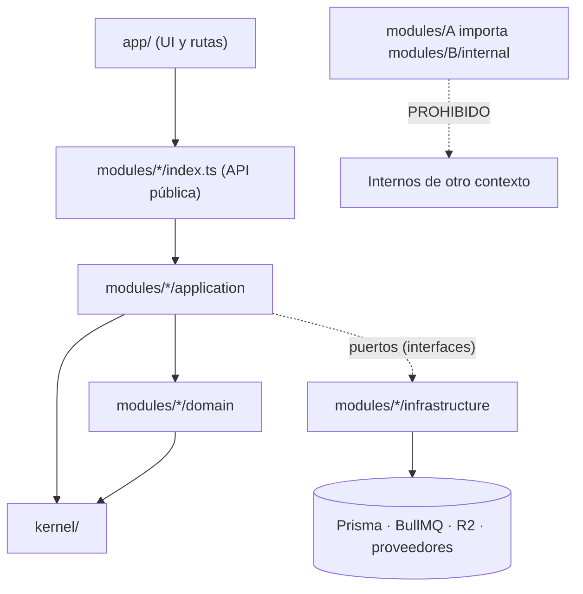

La regla se **hace cumplir en CI**, no por disciplina. Regla de ESLint (`no-restricted-imports`) más una comprobación con `dependency-cruiser`:

```javascript
// .eslintrc.cjs (fragmento) — fronteras entre contextos
module.exports = {
  overrides: [
    {
      files: ['src/modules/imagenes/**/*.ts'],
      rules: {
        'no-restricted-imports': ['error', {
          patterns: [
            { group: ['@/modules/automatizacion/*', '!@/modules/automatizacion'], message: 'Usa la API pública del contexto (index.ts).' },
            { group: ['@/modules/media/*', '!@/modules/media'], message: 'Usa la API pública del contexto (index.ts).' },
            { group: ['@/modules/web/*', '!@/modules/web'], message: 'Usa la API pública del contexto (index.ts).' },
            { group: ['@/app/*'], message: 'El dominio no depende de la capa de presentación.' },
          ],
        }],
      },
    },
    // se repite el bloque para automatizacion, media y web con sus propias exclusiones
  ],
};
```

```json
{
  "forbidden": [
    { "name": "domain-no-infra", "severity": "error",
      "from": { "path": "^src/modules/[^/]+/domain" },
      "to":   { "path": "^src/modules/[^/]+/(application|infrastructure)|^src/app" } },
    { "name": "no-cross-context-internals", "severity": "error",
      "from": { "path": "^src/modules/([^/]+)/" },
      "to":   { "path": "^src/modules/(?!\\1)[^/]+/(domain|application|infrastructure)" } },
    { "name": "no-circular", "severity": "error", "from": {}, "to": { "circular": true } }
  ]
}
```

#### 1.4.3 Eventos de dominio y *Transactional Outbox* (ADR-002, **Propuesta**: requiere tabla nueva)

Para que una escritura y la publicación de su evento sean **atómicas** (sin eventos perdidos si el proceso se cae entre ambos pasos), cada contexto escribe el evento en la misma transacción que el cambio de estado, y un despachador lo entrega después.

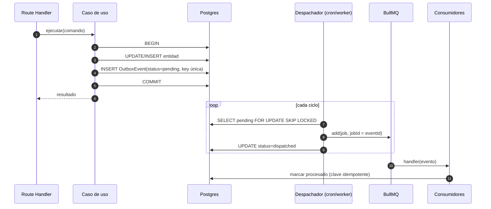

Garantías: **al menos una entrega** + **consumidores idempotentes** = efecto exactamente una vez. El `jobId` de BullMQ igual al `eventId` impide duplicados en cola.

```prisma
// Propuesta — requiere aprobación de Reiner. No se aplica ninguna migración sin ella.
model OutboxEvent {
  id            String    @id @default(cuid())
  workspaceId   String
  type          String    // 'image.generated' | 'web.form_submitted' | ...
  aggregateType String    // 'image_job' | 'workflow_run' | 'web_page' | ...
  aggregateId   String
  payload       Json
  schemaVersion Int       @default(1)
  status        String    @default("pending") // pending | dispatched | failed
  attempts      Int       @default(0)
  availableAt   DateTime  @default(now())
  dispatchedAt  DateTime?
  createdAt     DateTime  @default(now())

  @@index([status, availableAt])
  @@index([workspaceId, createdAt])
  @@index([aggregateType, aggregateId])
}
```

#### 1.4.4 DDD aplicado con medida (sin ceremonia)

| Concepto | Dónde se usa | Ejemplo concreto |
|---|---|---|
| **Agregado** | Una raíz con invariantes; se guarda y carga completo | `ImageJob` (cola, intentos, costo), `WorkflowDefinition` (disparador + pasos válidos), `WebPage` (árbol de bloques + versión) |
| **Objeto de valor** | Inmutable, igualdad por valor, se valida al construirse | `MediaRef`, `Money` (USD con 4 decimales), `ImagePrompt`, `CronExpression`, `Slug` |
| **Repositorio como puerto** | Interfaz en `application`; Prisma en `infrastructure` | `ImageJobRepository`, `WebPageRepository` |
| **Servicio de aplicación** | Un caso de uso por archivo, sin I/O directo | `QueueImageJob`, `PublishPage`, `ReplayWorkflowRun` |
| **Evento de dominio** | Hecho pasado, inmutable, versionado | `ImageGenerated@1` |
| **Anticorruption layer** | Un adaptador por proveedor externo | `GeminiImageProvider`, `OpenAiImageProvider`, `StabilityImageProvider` |
| **CQRS ligero** | Escrituras por casos de uso; lecturas de pantalla por *read models* con `TtlCache` | `GET /api/media`, `GET /api/dashboard/summary` |

No se adoptan *event sourcing* completo ni *aggregates* donde el CRUD es suficiente (p. ej. las preferencias de interfaz).

#### 1.4.5 Puertos y adaptadores para proveedores de IA

El código actual de `visual-agent.ts` ya concentra los proveedores de imagen; se formaliza como **puerto** para poder probarlo, medir su costo y reemplazarlo.

```typescript
// src/modules/imagenes/application/ports/image-provider.ts
export type ImageProviderId = 'gemini' | 'openai' | 'stabilityai';

export interface ImageGenerationRequest {
  readonly prompt: string;
  readonly negativePrompt?: string;
  readonly aspectRatio: '1:1' | '4:5' | '9:16' | '16:9';
  readonly seed?: number;
  readonly referenceMedia?: ReadonlyArray<MediaRef>;
  readonly idempotencyKey: string;
}

export interface ImageGenerationResult {
  readonly bytes: Uint8Array;
  readonly mime: 'image/png' | 'image/jpeg' | 'image/webp';
  readonly width: number;
  readonly height: number;
  readonly costUsd: number;
  readonly providerRequestId: string;
}

export interface ImageProvider {
  readonly id: ImageProviderId;
  /** Costo estimado antes de ejecutar; permite mostrar el precio en la interfaz. */
  estimate(request: ImageGenerationRequest): Money;
  generate(request: ImageGenerationRequest, signal: AbortSignal): Promise<ImageGenerationResult>;
}

export interface ImageProviderRegistry {
  get(id: ImageProviderId, workspaceId: string): Promise<ImageProvider>; // resuelve la clave BYOK del espacio
}
```

Toda implementación debe pasar la **misma suite de contrato** (`describe.each(providers)`), lo que garantiza el principio de sustitución de Liskov.

### 1.5 Contratos de API estándar

#### 1.5.1 Decisión: REST + SSE + Webhooks firmados; sin GraphQL (ADR-003, **Aceptada**)

| Criterio | REST (elegido) | GraphQL (descartado por ahora) |
|---|---|---|
| Encaje con el stack | Route Handlers de Next.js ya usados en todas las rutas existentes de `/api` | Requiere servidor y esquema adicional |
| Caché de cliente | `useCachedJson` (SWR por URL) funciona sin cambios | Exige cliente con caché normalizada |
| Casos de uso | Pantallas con lecturas predecibles (ya optimizadas con `select`/`take`) | Útil con muchos clientes distintos y grafos profundos; hoy no los hay |
| Riesgo | Bajo | Complejidad de autorización por campo, costo de consultas |

**Criterio de revisión**: si aparece una aplicación móvil nativa o clientes de terceros que necesiten componer datos de más de tres contextos en una sola pantalla, se evalúa GraphQL solo para lecturas.

#### 1.5.2 Sobre estándar de respuesta

```typescript
// src/kernel/http/contracts.ts
export interface ApiMeta {
  readonly requestId: string;       // = x-request-id; correlaciona logs y auditoría
  readonly cached?: boolean;
  readonly generatedAt: string;     // ISO 8601 UTC
}

export interface ApiSuccess<T> {
  readonly data: T;
  readonly meta: ApiMeta;
}

export interface Page<T> {
  readonly items: ReadonlyArray<T>;
  readonly nextCursor: string | null; // paginación por cursor opaco (estable ante inserciones)
  readonly total?: number;            // solo si es barato calcularlo
}

/** RFC 9457 (Problem Details for HTTP APIs). */
export interface ApiProblem {
  readonly type: string;     // URI estable, p. ej. 'https://crm-rai-agency.vercel.app/errors/quota-exceeded'
  readonly title: string;    // texto breve en español, apto para mostrar
  readonly status: number;
  readonly code: ErrorCode;  // catálogo cerrado (§2.4)
  readonly detail?: string;
  readonly instance: string; // = requestId
  readonly fieldErrors?: Readonly<Record<string, ReadonlyArray<string>>>;
  readonly retryAfterSec?: number;
}
```

Reglas de contrato:

- **Errores siempre con `application/problem+json`** y un `code` del catálogo cerrado; el cliente decide la UX según `code`, nunca según el texto.
- **Paginación por cursor** (`?cursor=…&limit=…`, `limit` máximo 100); nada de `offset` en listados que crecen.
- **Concurrencia optimista** con `ETag` en `GET` y `If-Match` en `PATCH/PUT`; conflicto → `412` con `code: 'CONFLICT'`.
- **Idempotencia** con cabecera `Idempotency-Key` en todo `POST` que cree trabajo, cobre costo o publique; la clave se guarda 24 h con la respuesta original (§3.1.4).
- **Límites de tasa** con `RateLimit-Limit`, `RateLimit-Remaining`, `RateLimit-Reset` y `Retry-After` en `429`, apoyados en `rate-limit.ts`.
- **Evolución aditiva**: no se quitan ni se renombran campos; las rupturas se anuncian con cabecera `Deprecation` y se mantienen 90 días. Versionado explícito (`/api/v2/...`) solo si una ruptura es inevitable.
- **Multi-tenencia**: ningún endpoint acepta `workspaceId` desde el cliente; se deriva siempre de `requireRole`.

#### 1.5.3 Contrato de ejemplo (OpenAPI 3.1) — trabajos de generación de imágenes

```yaml
openapi: 3.1.0
info:
  title: CRM RAI Agency — API de Imágenes
  version: 1.0.0
paths:
  /api/image-jobs:
    post:
      summary: Encola un trabajo de generación
      operationId: createImageJob
      parameters:
        - in: header
          name: Idempotency-Key
          required: true
          schema: { type: string, minLength: 16, maxLength: 80 }
      requestBody:
        required: true
        content:
          application/json:
            schema: { $ref: '#/components/schemas/CreateImageJob' }
      responses:
        '202':
          description: Aceptado; el progreso llega por SSE
          headers:
            Location: { schema: { type: string }, description: /api/image-jobs/{id} }
          content:
            application/json:
              schema: { $ref: '#/components/schemas/ImageJobEnvelope' }
        '402': { $ref: '#/components/responses/Problem' }   # QUOTA_EXCEEDED o BUDGET_EXCEEDED
        '409': { $ref: '#/components/responses/Problem' }   # clave de idempotencia con cuerpo distinto
        '429': { $ref: '#/components/responses/Problem' }
  /api/image-jobs/{id}:
    get:
      summary: Estado actual del trabajo
      parameters:
        - in: path
          name: id
          required: true
          schema: { type: string }
      responses:
        '200':
          content:
            application/json:
              schema: { $ref: '#/components/schemas/ImageJobEnvelope' }
  /api/image-jobs/{id}/events:
    get:
      summary: Progreso en tiempo real (Server-Sent Events)
      responses:
        '200':
          content:
            text/event-stream:
              schema: { type: string }
components:
  schemas:
    CreateImageJob:
      type: object
      required: [prompt, provider, aspectRatio, count]
      properties:
        prompt:      { type: string, minLength: 3, maxLength: 4000 }
        provider:    { type: string, enum: [gemini, openai, stabilityai] }
        aspectRatio: { type: string, enum: ['1:1', '4:5', '9:16', '16:9'] }
        count:       { type: integer, minimum: 1, maximum: 10 }
        gridRef:     { type: object, properties: { gridId: { type: string }, themeIndex: { type: integer }, slideNumber: { type: integer } } }
    ImageJobEnvelope:
      type: object
      required: [data, meta]
      properties:
        data: { $ref: '#/components/schemas/ImageJob' }
        meta: { type: object }
    ImageJob:
      type: object
      required: [id, status, progress, costUsd]
      properties:
        id:       { type: string }
        status:   { type: string, enum: [queued, running, succeeded, failed, cancelled] }
        progress: { type: number, minimum: 0, maximum: 1 }
        costUsd:  { type: number }
        mediaIds: { type: array, items: { type: string } }
        error:    { $ref: '#/components/schemas/Problem' }
    Problem:
      type: object
      required: [type, title, status, code, instance]
      properties:
        type: { type: string }
        title: { type: string }
        status: { type: integer }
        code: { type: string }
        detail: { type: string }
        instance: { type: string }
  responses:
    Problem:
      description: Error (RFC 9457)
      content:
        application/problem+json:
          schema: { $ref: '#/components/schemas/Problem' }
```

La especificación **no se escribe a mano**: se genera desde los esquemas `zod` (fuente única de tipos, validación y documentación). La dependencia de generación (`@asteasolutions/zod-to-openapi`) es una **Propuesta** y se aprueba junto con la fase 1.

#### 1.5.4 Webhooks salientes (para integraciones del cliente y para n8n)

Se generaliza el patrón de firma ya usado en el webhook de voz (`src/lib/voice/signature.ts`, firma verificada e idempotente).

```typescript
// Sobre del evento (compatible con CloudEvents 1.0)
export interface DomainEventEnvelope<TData = unknown> {
  readonly specversion: '1.0';
  readonly id: string;              // = OutboxEvent.id; clave de idempotencia del receptor
  readonly source: '/crm-rai-agency';
  readonly type: DomainEventType;   // p. ej. 'com.raiagency.image.generated'
  readonly time: string;            // ISO 8601 UTC
  readonly subject: string;         // id del agregado
  readonly datacontenttype: 'application/json';
  readonly data: TData;
  readonly workspaceid: string;
  readonly schemaversion: number;
}
```

```json
{
  "specversion": "1.0",
  "id": "ckx9t2q8m0001",
  "source": "/crm-rai-agency",
  "type": "com.raiagency.web.form_submitted",
  "time": "2026-10-17T14:05:11Z",
  "subject": "wp_8f3a",
  "datacontenttype": "application/json",
  "workspaceid": "ws_quadro",
  "schemaversion": 1,
  "data": { "formId": "contacto", "fields": { "nombre": "Ana", "email": "ana@example.com" } }
}
```

| Aspecto | Regla |
|---|---|
| Firma | Cabecera `X-RAI-Signature: t=<epoch>,v1=<hex(HMAC-SHA256(secret, t + "." + body))>`; ventana de tolerancia de 5 minutos contra repetición |
| Entrega | Al menos una vez; reintentos a 1 min, 5 min, 30 min, 2 h, 12 h; después, estado `failed` visible en la interfaz con botón «Reenviar» |
| Idempotencia | El receptor deduplica por `id`; el emisor nunca reutiliza un `id` para un contenido distinto |
| Secretos | Uno por endpoint, rotables, guardados cifrados (mismo mecanismo AES-256-GCM de `ApiKey`); nunca se muestran después de crearse |
| Versionado | `schemaversion` por tipo de evento; se mantienen las dos últimas versiones |

#### 1.5.5 Progreso en tiempo real: un solo canal para todos los trabajos

La ruta actual `GET /api/events/[campaignId]` (SSE sobre Redis) se generaliza a un contrato único `JobProgressEvent`, de modo que el Generador, el motor de automatizaciones, los trabajos de procesamiento de medios y las publicaciones de sitios se vean igual en la interfaz.

```typescript
export type JobKind = 'image' | 'workflow_run' | 'media_process' | 'web_publish';

export interface JobProgressEvent {
  readonly jobId: string;
  readonly kind: JobKind;
  readonly status: 'queued' | 'running' | 'succeeded' | 'failed' | 'cancelled';
  readonly progress: number;               // 0..1
  readonly step?: string;                   // etiqueta legible: «Subiendo a la biblioteca»
  readonly etaSec?: number;
  readonly emittedAt: string;
  readonly error?: Pick<ApiProblem, 'code' | 'title' | 'detail'>;
}
```

Cliente: un hook `useJobProgress(jobId)` abre `EventSource`, **reconecta con retroceso exponencial** enviando `Last-Event-ID` para no perder eventos, y cae a *polling* cada 3 s si SSE no está disponible (límite de 300 s por conexión en Vercel). El servidor retiene los últimos 50 eventos por trabajo en una lista Redis con expiración de 1 h para poder reanudar.

---

## 2. Estándares de ingeniería: Clean Code, estado, errores y deuda técnica cero

### 2.1 SOLID aplicado al código real del proyecto

El repositorio ya contiene un ejemplo de referencia: `src/lib/publish-runner.ts` recibe sus dependencias por parámetro (`RunnerDeps`, `RunnerDb`) y por eso se prueba sin base de datos. **Ese es el patrón obligatorio para todo ejecutor asíncrono nuevo.**

| Principio | Regla operativa en este proyecto | Violación típica que se rechaza en revisión |
|---|---|---|
| **S** — Responsabilidad única | Un *Route Handler* hace cuatro cosas y solo cuatro: autenticar (`requireRole`), validar (`zod`), delegar a un caso de uso, mapear el resultado a HTTP | Un handler que consulta Prisma, llama a un proveedor de IA y arma el HTML de respuesta |
| **O** — Abierto/cerrado | Un proveedor, una acción de automatización o un tipo de bloque web nuevo se añaden **registrando** una implementación, sin editar un `switch` central | Añadir `case 'nuevo'` en tres archivos |
| **L** — Sustitución de Liskov | Todas las implementaciones de un puerto pasan la misma suite de contrato | Un proveedor que lanza una excepción distinta o devuelve `costUsd` en otra unidad |
| **I** — Segregación de interfaces | Puertos pequeños (`ImageGenerator`, `ImageStorage`, `JobProgressPublisher`), no un `ImageService` con 15 métodos | Inyectar el repositorio entero para usar un método |
| **D** — Inversión de dependencias | `application` depende de interfaces; `infrastructure` las implementa; el *composition root* (`modules/<ctx>/index.ts`) las conecta | `import { prisma } from '@/lib/db'` dentro de `domain/` |

**Ejemplo — registro abierto de acciones de automatización** (sustituye al `switch` creciente de `actions.ts`):

```typescript
// src/modules/automatizacion/application/action-registry.ts
export interface ActionHandler<TConfig> {
  readonly type: string;                       // 'send_message' | 'generate_image' | ...
  readonly configSchema: z.ZodType<TConfig>;   // valida la configuración al guardar el flujo
  readonly sideEffect: 'none' | 'external' | 'costly';
  execute(config: TConfig, ctx: AutomationContext, signal: AbortSignal): Promise<ActionResult>;
}

export class ActionRegistry {
  private readonly handlers = new Map<string, ActionHandler<unknown>>();

  register<T>(handler: ActionHandler<T>): this {
    if (this.handlers.has(handler.type)) {
      throw new AppError('INTERNAL', `Acción duplicada: ${handler.type}`);
    }
    this.handlers.set(handler.type, handler as ActionHandler<unknown>);
    return this;
  }

  tryResolve(type: string): ActionHandler<unknown> | undefined {
    return this.handlers.get(type);
  }

  resolve(type: string): ActionHandler<unknown> {
    const handler = this.tryResolve(type);
    if (!handler) throw new AppError('VALIDATION_FAILED', `Acción desconocida: ${type}`);
    return handler;
  }
}
```

### 2.2 DRY y KISS con criterio medible

| Regla | Umbral | Cómo se hace cumplir |
|---|---|---|
| Regla de tres | Se abstrae al **tercer** uso real, nunca al segundo | Revisión de PR; las abstracciones prematuras se rechazan |
| Tamaño de archivo | Revisión obligatoria de cohesión a partir de **500 líneas** (señal, no ley) | `scripts/gate.mjs` lista los archivos que superan el umbral |
| Tamaño de función | Máximo **40 líneas** y complejidad ciclomática ≤ **10** | ESLint: `max-lines-per-function`, `complexity` |
| Anidamiento | Máximo **3** niveles; se prefieren *guard clauses* | ESLint: `max-depth` |
| Parámetros | Máximo **4**; si hay más, objeto con nombre | ESLint: `max-params` |
| Duplicación | Bloques idénticos > 12 líneas en 2+ lugares se extraen | `jscpd` en CI con umbral de 3 % |
| Constantes | Sin números ni cadenas mágicas: constantes con nombre en el módulo dueño | Revisión; ejemplo bueno: `MAX_ATTEMPTS`, `STALE_LOCK_MS` en `scheduled-posts.ts` |
| Nombres | Dominio en español de producto (`Sede`, `Flujo`), técnica en inglés (`Repository`); sin abreviaturas ambiguas | Glosario (Anexo A) |

**KISS en la práctica:** una nueva dependencia solo entra si resuelve un problema que 30 líneas propias no resuelven bien. Por eso el almacén de estado de cliente es un `useSyncExternalStore` de ~40 líneas (§2.3.3) y no una librería nueva.

### 2.3 Gestión de estado

#### 2.3.1 Dónde vive cada tipo de estado

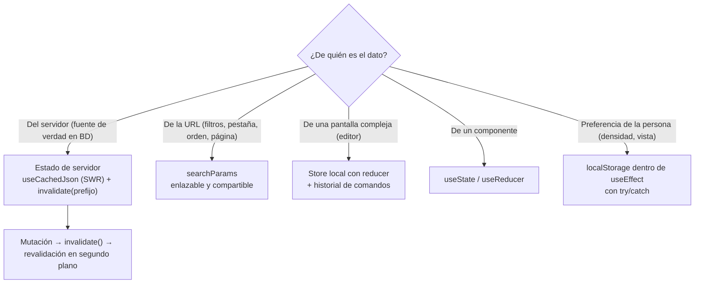

| Tipo | Mecanismo | Regla |
|---|---|---|
| Servidor | `useCachedJson(url, { ttlMs })`, `prefetchJson` al pasar el cursor, `invalidate(prefijo)` tras mutar | Nunca duplicar datos de servidor en `useState`; se leen de la caché |
| URL | `useSearchParams` + `router.replace` | Todo filtro que la persona quiera compartir o recuperar al volver atrás |
| Editor | Store propio (§2.3.3) | Solo para editores con deshacer/rehacer: flujo de automatización y editor web |
| Local | `useState`/`useReducer` | Estado efímero de un componente |
| Preferencias | `localStorage` **solo dentro de `useEffect`** (evita errores de hidratación) con `try/catch` | Nunca bloquear el render si el almacenamiento falla; las preferencias que deban viajar con la cuenta pasan al servidor (módulo Configuración general, Ola 4) |

#### 2.3.2 Actualizaciones optimistas con reversión

```typescript
// src/kernel/client/optimistic.ts
export async function mutateOptimistic<T, R>(opts: {
  key: string;                                   // clave de caché SWR
  apply: (current: T) => T;                      // cambio inmediato en pantalla
  request: () => Promise<R>;                     // llamada al servidor
  onError: (e: unknown) => void;                 // toast con el mensaje del catálogo
}): Promise<R | undefined> {
  const snapshot = getCached<T>(opts.key);
  if (snapshot) setCached(opts.key, opts.apply(snapshot.data));
  try {
    const result = await opts.request();
    invalidate(opts.key);                        // confirma con la fuente de verdad
    return result;
  } catch (e) {
    if (snapshot) setCached(opts.key, snapshot.data); // reversión exacta
    opts.onError(e);
    return undefined;
  }
}
```

Beneficio de experiencia: etiquetar, mover o borrar un activo se siente **instantáneo**; si el servidor rechaza, la pantalla vuelve al estado anterior con un aviso claro.

#### 2.3.3 Store mínimo para editores con historial (sin dependencias nuevas)

```typescript
// src/kernel/client/create-store.ts
import { useSyncExternalStore } from 'react';

export interface Command<S> {
  readonly label: string;                     // «Mover bloque Hero»
  readonly apply: (state: S) => S;
  readonly revert: (state: S) => S;
  readonly mergeKey?: string;                 // comandos con la misma clave se fusionan (arrastres, escritura)
}

export interface Store<S> {
  getState(): S;
  subscribe(listener: () => void): () => void;
  dispatch(command: Command<S>): void;
  undo(): void;
  redo(): void;
  canUndo(): boolean;
  canRedo(): boolean;
}

export function createStore<S>(initial: S, limit = 200): Store<S> {
  let state = initial;
  const past: Command<S>[] = [];
  const future: Command<S>[] = [];
  const listeners = new Set<() => void>();
  const emit = () => listeners.forEach((l) => l());

  return {
    getState: () => state,
    subscribe(listener) {
      listeners.add(listener);
      return () => { listeners.delete(listener); };
    },
    dispatch(command) {
      state = command.apply(state);
      const last = past[past.length - 1];
      if (last?.mergeKey && last.mergeKey === command.mergeKey) {
        past[past.length - 1] = {
          label: command.label,
          mergeKey: command.mergeKey,
          apply: (s) => command.apply(last.apply(s)),
          revert: (s) => last.revert(command.revert(s)),
        };
      } else {
        past.push(command);
        if (past.length > limit) past.shift();
      }
      future.length = 0;
      emit();
    },
    undo() {
      const command = past.pop();
      if (!command) return;
      state = command.revert(state);
      future.push(command);
      emit();
    },
    redo() {
      const command = future.pop();
      if (!command) return;
      state = command.apply(state);
      past.push(command);
      emit();
    },
    canUndo: () => past.length > 0,
    canRedo: () => future.length > 0,
  };
}

export function useStore<S, T>(store: Store<S>, selector: (s: S) => T): T {
  return useSyncExternalStore(store.subscribe, () => selector(store.getState()), () => selector(store.getState()));
}
```

Cada módulo con editor (flujos y páginas web) usa **la misma** implementación; los atajos `Ctrl/Cmd+Z` y `Ctrl/Cmd+Shift+Z` se registran una vez en el kernel.

### 2.4 Errores centralizados, registro (logging) y TypeScript estricto

#### 2.4.1 Jerarquía de errores y catálogo cerrado de códigos

```typescript
// src/kernel/errors.ts
export const ERROR_CODES = {
  VALIDATION_FAILED:   { status: 422, title: 'Revisa los datos ingresados' },
  UNAUTHENTICATED:     { status: 401, title: 'Tu sesión expiró' },
  FORBIDDEN:           { status: 403, title: 'No tienes permiso para esta acción' },
  NOT_FOUND:           { status: 404, title: 'No encontramos lo que buscas' },
  CONFLICT:            { status: 412, title: 'Alguien más cambió esto; recarga para continuar' },
  IDEMPOTENCY_MISMATCH:{ status: 409, title: 'Esta solicitud ya se usó con otros datos' },
  QUOTA_EXCEEDED:      { status: 402, title: 'Alcanzaste el límite de tu plan' },
  BUDGET_EXCEEDED:     { status: 402, title: 'Se alcanzó el tope de gasto configurado' },
  RATE_LIMITED:        { status: 429, title: 'Demasiadas solicitudes; intenta en unos segundos' },
  PROVIDER_FAILED:     { status: 502, title: 'El proveedor externo no respondió' },
  PROVIDER_TIMEOUT:    { status: 504, title: 'El proveedor externo tardó demasiado' },
  UNSUPPORTED_MEDIA:   { status: 415, title: 'Tipo de archivo no permitido' },
  TOO_LARGE:           { status: 413, title: 'El archivo supera el tamaño permitido' },
  INTERNAL:            { status: 500, title: 'Algo salió mal de nuestro lado' },
} as const;

export type ErrorCode = keyof typeof ERROR_CODES;

export class AppError extends Error {
  constructor(
    readonly code: ErrorCode,
    message: string,
    readonly options: {
      readonly cause?: unknown;
      readonly fieldErrors?: Readonly<Record<string, ReadonlyArray<string>>>;
      readonly retryAfterSec?: number;
      readonly expose?: boolean;   // false → el cliente ve solo el título genérico
    } = {},
  ) {
    super(message, { cause: options.cause });
    this.name = 'AppError';
  }
}

/** Convierte cualquier excepción en un Problem seguro (nunca filtra rutas, SQL ni secretos). */
export function toProblem(error: unknown, requestId: string): ApiProblem {
  const app = error instanceof AppError ? error : new AppError('INTERNAL', 'Error no controlado', { cause: error, expose: false });
  const def = ERROR_CODES[app.code];
  return {
    type: `https://crm-rai-agency.vercel.app/errors/${app.code.toLowerCase().replace(/_/g, '-')}`,
    title: def.title,
    status: def.status,
    code: app.code,
    detail: app.options.expose === false ? undefined : app.message,
    instance: requestId,
    fieldErrors: app.options.fieldErrors,
    retryAfterSec: app.options.retryAfterSec,
  };
}
```

Un único envoltorio `withApi(handler, { roles, schema })` aplica `requireRole`, valida con `zod`, genera `requestId`, registra, convierte excepciones con `toProblem` y devuelve `application/problem+json`. **Ningún handler nuevo usa `try/catch` propio para formatear errores.** El código existente que ya usa `safeError` y `catch (e: unknown)` migra por oleadas (§4).

#### 2.4.2 Registro estructurado

Hoy el proyecto no tiene logger de aplicación (el worker usa `console.log` con una excepción de ESLint justificada). Se introduce uno mínimo, sin dependencias, que emite una línea JSON por evento:

```typescript
// src/kernel/logger.ts
type Level = 'debug' | 'info' | 'warn' | 'error';
const REDACT = /(authorization|cookie|password|secret|token|api[-_]?key|signature)/i;

function redact(value: unknown, depth = 0): unknown {
  if (depth > 4 || value === null || typeof value !== 'object') return value;
  return Object.fromEntries(
    Object.entries(value as Record<string, unknown>).map(([k, v]) => [k, REDACT.test(k) ? '[REDACTED]' : redact(v, depth + 1)]),
  );
}

export function createLogger(base: Record<string, unknown>) {
  const emit = (level: Level, msg: string, fields?: Record<string, unknown>) => {
    const line = JSON.stringify({ t: new Date().toISOString(), level, msg, ...base, ...(redact(fields) as object) });
    (level === 'error' ? process.stderr : process.stdout).write(line + '\n');
  };
  return {
    debug: (m: string, f?: Record<string, unknown>) => { if (process.env.LOG_LEVEL === 'debug') emit('debug', m, f); },
    info:  (m: string, f?: Record<string, unknown>) => emit('info', m, f),
    warn:  (m: string, f?: Record<string, unknown>) => emit('warn', m, f),
    error: (m: string, f?: Record<string, unknown>) => emit('error', m, f),
    child: (extra: Record<string, unknown>) => createLogger({ ...base, ...extra }),
  };
}
```

| Campo obligatorio | Origen | Para qué sirve |
|---|---|---|
| `requestId` | cabecera `x-request-id` o generado | Correlacionar interfaz, API, worker y `AuditEvent` |
| `workspaceId`, `userId` | `requireRole` | Soporte por cliente; nunca se registran correos ni teléfonos |
| `module`, `useCase` | constante del caso de uso | Filtrar por contexto |
| `durationMs`, `outcome` | envoltorio `withApi` | Medir la latencia objetivo de la API (§4.5) |
| `jobId` | trabajos asíncronos | Seguir un trabajo de punta a punta |

Regla: los **secretos y datos personales no entran a los registros** (el filtro de redacción es defensa en profundidad, no excusa). `AuditEvent` sigue siendo el registro de *quién hizo qué*; el logger es el registro de *qué le pasó al sistema*.

#### 2.4.3 TypeScript estricto: estado actual y escalera de endurecimiento

`tsconfig.json` ya declara `"strict": true`. Se endurece por escalones, **un indicador por vez**, cada escalón en su propio commit y solo si `tsc --noEmit` queda en 0:

| Escalón | Indicador | Beneficio | Condición de aceptación |
|---|---|---|---|
| 1 | `noImplicitOverride`, `noFallthroughCasesInSwitch`, `forceConsistentCasingInFileNames` | Sin impacto funcional | 0 errores tras activar |
| 2 | `noUncheckedIndexedAccess` | Elimina los `undefined` ocultos de `arr[i]` y `record[key]` | 0 errores; correcciones con *guard clauses*, nunca con `!` |
| 3 | `exactOptionalPropertyTypes` | Distingue «ausente» de «`undefined`» (importa en `PATCH`) | 0 errores |
| 4 | `noPropertyAccessFromIndexSignature` | Fuerza la sintaxis explícita en diccionarios | 0 errores |

Reglas complementarias de ESLint (errores, no advertencias): `@typescript-eslint/no-explicit-any`, `no-non-null-assertion`, `consistent-type-imports`, `switch-exhaustiveness-check`, `no-floating-promises`, `no-misused-promises`. Los límites externos (JSON de BD, cuerpos de petición, respuestas de proveedores) se tratan como `unknown` y se convierten con `zod`; los campos `Json` de Prisma se parsean con un esquema al leerlos (`ContentGrid.themes`, `Workflow.steps`, `Workflow.trigger`).

### 2.5 Política de Deuda Técnica Cero

**Definición operativa.** Un cambio no se integra si introduce código muerto, comentarios con código, `TODO`/`FIXME`/`HACK`, parches temporales, advertencias de linter, `any` explícito, pruebas omitidas (`skip`/`only`) o dependencias sin uso. La deuda que *ya existe* no se oculta: se **registra con dueño, impacto y fecha** en `docs/planning/panel-control.html` y se paga en una fase concreta; no se admite deuda sin registro.

#### 2.5.1 Puertas de calidad (todas bloqueantes)

| Puerta | Comando | Umbral |
|---|---|---|
| Tipos | `npm run typecheck` | 0 errores |
| Lint | `npm run lint` | 0 errores y 0 advertencias (`--max-warnings 0`) |
| Pruebas unitarias | `npm test` | 100 % verdes; cobertura de ramas ≥ **80 %** en `modules/*/domain` y `application`, ≥ **60 %** global |
| Cobertura en cambios | `vitest --coverage` con umbral por archivo modificado | Archivos tocados no pueden bajar su cobertura |
| Compilación | `npm run build` | Éxito; es la única forma de detectar imports de CSS rotos (lección del `wizard.css`) |
| Fronteras | `depcruise src --config .dependency-cruiser.json` | 0 violaciones, 0 ciclos |
| Duplicación | `jscpd src --threshold 3` | ≤ 3 % |
| Código muerto | `knip` (exportaciones, archivos y dependencias sin uso) | 0 hallazgos nuevos |
| Reglas del proyecto | `node scripts/rules-guard.mjs` y `scripts/gate.mjs` | Sin infracciones (blur, nombres prohibidos, secretos) |
| Seguridad | `npm audit --omit=dev --audit-level=high` y escaneo de secretos | 0 críticos/altos |
| E2E | `npm run test:e2e` (Playwright) en los flujos críticos de §4.4 | Verdes en staging antes de cada fusión |

#### 2.5.2 Flujo de integración continua (propuesto sobre `.github/workflows/ci.yml` existente)

```yaml
name: ci
on:
  pull_request:
  push:
    branches: [main]
concurrency:
  group: ci-${{ github.ref }}
  cancel-in-progress: true
jobs:
  verify:
    runs-on: ubuntu-latest
    timeout-minutes: 20
    services:
      redis:
        image: redis:7
        ports: ['6379:6379']
    steps:
      - uses: actions/checkout@v4
      - uses: actions/setup-node@v4
        with: { node-version: 20, cache: npm }
      - run: npm ci
      - run: npx prisma generate
      - run: npx prisma validate
      - run: npm run typecheck
      - run: npm run lint -- --max-warnings 0
      - run: npx depcruise src --config .dependency-cruiser.json
      - run: npx knip
      - run: npx jscpd src --threshold 3 --silent
      - run: npm test -- --coverage
      - run: npm run build
        env:
          NEXT_TELEMETRY_DISABLED: '1'
      - run: node scripts/rules-guard.mjs
      - run: npm audit --omit=dev --audit-level=high
  e2e:
    needs: verify
    if: github.event_name == 'pull_request'
    runs-on: ubuntu-latest
    timeout-minutes: 25
    steps:
      - uses: actions/checkout@v4
      - uses: actions/setup-node@v4
        with: { node-version: 20, cache: npm }
      - run: npm ci
      - run: npx playwright install --with-deps chromium
      - run: npm run test:e2e
```

Notas de seguridad del flujo: ningún secreto de producción entra al CI; las pruebas usan variables de **staging** o dobles de prueba; el CI **no despliega** (el despliegue sigue exigiendo aprobación explícita de Reiner). Las dependencias nuevas de esta sección (`dependency-cruiser`, `knip`, `jscpd`) son de desarrollo y se instalan en la fase 1 con aprobación.

#### 2.5.3 Estrategia de pruebas (pirámide con propósito)

| Capa | Qué prueba | Herramienta | Regla |
|---|---|---|---|
| Dominio | Reglas puras: transiciones de estado, cálculo de costo, validación de DAG | `vitest` | Sin I/O; ejecución < 1 s por archivo |
| Aplicación | Casos de uso con puertos simulados (dobles en memoria) | `vitest` | Cubre éxito, cada error del catálogo y la idempotencia |
| Contrato | Cada adaptador cumple su puerto (`describe.each`) | `vitest` | Proveedores de imagen, almacenamiento, publicador |
| Integración | Repositorios Prisma contra una base efímera; BullMQ contra Redis de CI | `vitest` | Solo rutas críticas |
| Componentes | Estados de interfaz (carga, vacío, error, éxito) | `vitest` + Testing Library | Los cuatro estados siempre |
| E2E | Recorridos de valor de §4.4 | Playwright | Pocos, estables, en staging |

**Prueba de regresión obligatoria por defecto corregido**: todo error encontrado en producción o en revisión se reproduce primero con una prueba que falla; la corrección la deja en verde.

#### 2.5.4 Definition of Done (por cambio)

1. Alcance cumplido y criterio de aceptación verificado con evidencia (salida de comandos, captura o prueba).
2. Todas las puertas de §2.5.1 en verde.
3. Cuatro estados de interfaz cubiertos (carga con `Skeleton`, vacío con `EmptyState`, error con mensaje accionable, éxito) y revisión a 320, 768 y 1440 px.
4. Documentación al día: este documento (si cambió una decisión), `docs/DISENO-EFECTOS.md` (si hay efectos nuevos), `docs/planning/roadmap-agentes-rai.html` y `docs/ESTADO-SESION.md`.
5. Sin secretos, sin código muerto, sin `any`, sin advertencias.
6. Registro de auditoría (`logAudit`) en toda escritura.

---

## 3. Arquitectura y experiencia por módulo

Cada módulo sigue la misma plantilla: **(a)** estado actual y brecha, **(b)** arquitectura objetivo, **(c)** modelo de datos, **(d)** contratos, **(e)** diseño de experiencia con su justificación técnica, **(f)** rendimiento, **(g)** pruebas y **(h)** riesgos.

### 3.1 Generador de Imágenes

#### 3.1.1 Estado actual y brecha

| Aspecto | Hoy | Brecha | Consecuencia para la persona |
|---|---|---|---|
| Ejecución | `POST /api/content-grids/[id]/generate-image` genera **dentro de la petición** (`maxDuration = 120`) | Una pestaña cerrada o un corte de red pierde el trabajo y el costo ya pagado | Miedo a navegar mientras se genera |
| Concurrencia | Una imagen por llamada desde el cliente | Sin límite por espacio de trabajo ni por proveedor | Riesgo de 429 del proveedor y de gasto descontrolado |
| Idempotencia | Reemplaza el activo existente de `(themeIndex, slideNumber)` | Un doble clic puede cobrar dos veces | Costo duplicado |
| Costo | Se obtiene `cost` del proveedor y se calcula en `cost-estimator.ts` | No hay tope mensual por espacio ni vista del gasto acumulado | Sorpresas en la factura |
| Resultado | `ContentGridAsset` atado a una grilla | No hay vínculo con la biblioteca | La imagen «no aparece» donde se espera |
| Progreso | Estado local en el asistente (`grid-progress.ts`) | No sobrevive a recargas | Se pierde el contexto al volver |

#### 3.1.2 Arquitectura objetivo

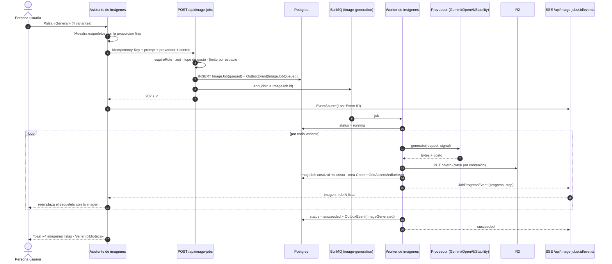

**Decisión de cola (ADR-005, Propuesta):** una cola **nueva** `image-generation` en el mismo Redis, separada de `content-pipeline`. Razón: la cola de campañas tiene `attempts: 1` por decisión de Reiner (pausar en fallo, sin reintento automático) y semántica de «pipeline de varios agentes»; las imágenes necesitan límites y métricas propias. Se mantiene la **misma política de no reintentar automáticamente un trabajo que ya cobró**: un fallo transitorio *antes* de recibir bytes del proveedor puede reintentarse hasta 2 veces con retroceso exponencial (no hubo cobro); después de recibir el resultado no se reintenta nunca la generación.

```typescript
// src/modules/imagenes/infrastructure/queue.ts
export const IMAGE_QUEUE = 'image-generation';

export const imageQueueOptions = {
  defaultJobOptions: {
    attempts: 3,                                         // solo para fallos previos al cobro (ver clasificador)
    backoff: { type: 'exponential', delay: 4_000 },
    removeOnComplete: { count: 500, age: 7 * 24 * 3600 },
    removeOnFail: { count: 2_000 },
  },
} as const;

/** Límite por proveedor: protege contra 429 y fija el techo de gasto por minuto. */
export const providerLimiter: Record<ImageProviderId, { max: number; duration: number }> = {
  gemini:      { max: 30, duration: 60_000 },
  openai:      { max: 20, duration: 60_000 },
  stabilityai: { max: 20, duration: 60_000 },
};

export function classifyFailure(error: unknown): 'retry' | 'final' {
  if (error instanceof AppError) {
    return error.code === 'PROVIDER_TIMEOUT' || error.code === 'RATE_LIMITED' ? 'retry' : 'final';
  }
  return 'final'; // un error desconocido nunca se reintenta: podría haber cobrado
}
```

**Control de admisión por espacio de trabajo** (evita que un espacio monopolice la cola): contador en Redis `image:inflight:{workspaceId}` con `INCR` al encolar y `DECR` al terminar, máximo 3 trabajos simultáneos y 20 en cola por espacio; el exceso responde `429 RATE_LIMITED` con `Retry-After`. **Tope de gasto:** antes de encolar se suma `ImageJob.costUsd` del mes y se compara con el tope configurado; si la estimación lo supera, `402 BUDGET_EXCEEDED` y la interfaz muestra cuánto falta, no un error genérico.

**Compatibilidad hacia atrás:** la ruta actual `generate-image` se mantiene como **fachada** detrás del indicador `IMAGE_QUEUE_MODE` (`inline` por defecto, `queue` cuando hay `REDIS_URL`): en `queue` crea el trabajo y devuelve `202`; en `inline` conserva el comportamiento actual. Así se activa por entorno y se revierte sin despliegue.

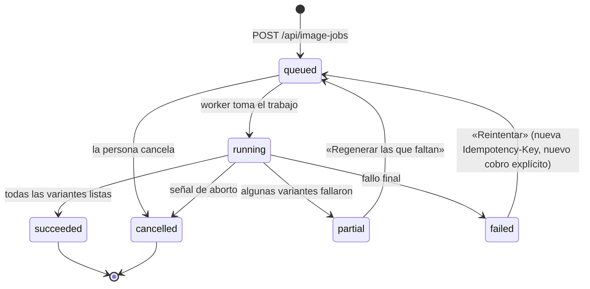

#### 3.1.3 Modelo de datos (**Propuesta**; requiere aprobación y migración *expand-only*)

```prisma
model ImageJob {
  id             String    @id @default(cuid())
  workspaceId    String
  userId         String
  gridId         String?   // vínculo opcional con el asistente (ContentGrid)
  themeIndex     Int?
  slideNumber    Int?
  provider       String    // gemini | openai | stabilityai
  prompt         String    @db.Text
  negativePrompt String?   @db.Text
  aspectRatio    String    @default("1:1")
  requestedCount Int       @default(1)
  completedCount Int       @default(0)
  status         String    @default("queued") // queued | running | succeeded | partial | failed | cancelled
  costUsd        Decimal   @default(0) @db.Decimal(10, 4)
  estimatedUsd   Decimal   @default(0) @db.Decimal(10, 4)
  errorCode      String?
  errorDetail    String?   @db.Text
  idempotencyKey String
  seed           Int?
  startedAt      DateTime?
  finishedAt     DateTime?
  createdAt      DateTime  @default(now())
  updatedAt      DateTime  @updatedAt

  workspace Workspace @relation(fields: [workspaceId], references: [id])

  @@unique([workspaceId, idempotencyKey])
  @@index([workspaceId, createdAt])
  @@index([workspaceId, status])
  @@index([gridId])
}
```

El campo `ContentGrid.themes` (Json) **no cambia**: la imagen resultante se sigue escribiendo en `slides[].imageUrl` para no romper el asistente; el `ImageJob` aporta trazabilidad y costo.

#### 3.1.4 Idempotencia

La clave `(workspaceId, idempotencyKey)` es única. Reglas: misma clave y mismo cuerpo → se devuelve el trabajo original (`200` con `Idempotent-Replayed: true`); misma clave y cuerpo distinto → `409 IDEMPOTENCY_MISMATCH`. El cliente genera la clave **una vez por intención** (al abrir el asistente de generación), de modo que un doble clic o un reintento de red nunca cobran dos veces; «Regenerar» crea una clave nueva a propósito.

#### 3.1.5 Experiencia (UX) y su justificación técnica

| Elemento de experiencia | Diseño | Justificación técnica | Métrica |
|---|---|---|---|
| **Esqueletos con proporción final** | Cada variante reserva su caja con `aspect-ratio` del pedido desde el primer instante, con `Skeleton` del sistema | Sin saltos de diseño al llegar la imagen | CLS = 0 en el panel de resultados |
| **Progreso informativo** | Etiqueta de paso («En cola · posición 2», «Generando 2 de 4», «Guardando en la biblioteca») + barra; sin animaciones decorativas | `JobProgressEvent` (§1.5.5) trae `step` y `etaSec` | La persona sabe qué pasa y cuánto falta |
| **Sin bloqueo** | Cerrar el asistente o navegar no cancela; el trabajo sigue y aparece en la **bandeja de trabajos** del encabezado | El trabajo vive en cola, no en la petición | 0 trabajos perdidos por navegación |
| **Precio antes de pulsar** | El botón dice «Generar · ≈ US$ 0,16»; si supera el tope, se explica cuánto margen queda | `ImageProvider.estimate()` | 0 sorpresas de costo |
| **Notificaciones (toasts)** | Éxito (5 s, acción «Ver»), error (persistente, acción «Reintentar»), parcial (persistente, «Regenerar las que faltan»). Un solo componente `Toast` con cola, máximo 3 visibles, `role="status"` / `role="alert"` | Catálogo de errores (§2.4.1) → mensaje y acción por `code`; accesible | Tasa de reintento exitoso |
| **Historial** | Línea de tiempo con filtros por estado, proveedor, rango de fechas y costo; búsqueda por texto del prompt; favoritos; acciones: reutilizar prompt, variar, comparar, usar en página, descargar | `GET /api/image-jobs?cursor=` con índice `(workspaceId, createdAt)`; lectura vía `useCachedJson` | Tiempo a «reutilizar un prompt anterior» < 3 s |
| **Arrastrar y soltar** | (1) Soltar imágenes de referencia sobre el prompt; (2) reordenar láminas del carrusel; (3) arrastrar una imagen del historial a una lámina. Alternativa por teclado: botones «Mover a la izquierda/derecha» y selección con Enter | Mismas primitivas que el editor web (§3.4.6); accesible por teclado y táctil | Sin tareas imposibles sin ratón |
| **Comparar variantes** | Vista A/B con deslizador vertical (sin desenfoque); marcar favorita; descartar | Solo `transform`/`opacity` | Menos pasos para elegir |
| **Calidad guiada** | Las verificaciones de `grid-quality.ts` se muestran como lista de comprobación (proporción, texto legible, contraste con marca) antes de programar | Reutiliza lo que ya existe | Menos reprocesos |
| **Estados vacíos** | `EmptyState` con ejemplo de prompt y botón «Probar con una plantilla» (`grid-templates.ts`) | Activación sin página en blanco | Tiempo a la primera imagen |

**Accesibilidad:** regiones `aria-live="polite"` para el progreso, foco devuelto al botón tras cerrar diálogos, contraste AA verificado contra los tokens, objetivos táctiles ≥ 44 px, `prefers-reduced-motion` respetado.

#### 3.1.6 Rendimiento y operación

- **Tiempo hasta aceptación del trabajo (API):** < 100 ms p95, porque la petición solo valida, escribe una fila y encola; la generación (segundos a decenas de segundos) ocurre fuera.
- **Subida a R2** con clave por contenido (`sha256`) → reintentos sin duplicar objetos; `Cache-Control: public, max-age=31536000, immutable`.
- **Métricas** (registro estructurado): `image_job_duration_ms{provider}`, `image_job_cost_usd{provider}`, `image_job_failed_total{code}`, `queue_wait_ms`, `inflight_per_workspace`.
- **Alertas internas:** tasa de fallos > 10 % en 15 min por proveedor; cola con espera p95 > 60 s.

#### 3.1.7 Pruebas

Dominio: transiciones de estado válidas e inválidas, cálculo de costo acumulado, regla de tope. Aplicación: `QueueImageJob` con puertos en memoria (idempotencia, admisión, presupuesto). Contrato: los tres adaptadores de proveedor frente a respuestas grabadas. Integración: worker contra Redis de CI (éxito, parcial, aborto). E2E: «generar 2 variantes y verlas en la biblioteca» con proveedor simulado.

#### 3.1.8 Riesgos

| Riesgo | Probabilidad | Impacto | Mitigación |
|---|---|---|---|
| El proveedor cobra aunque el worker caiga a mitad | Media | Costo | `costUsd` se persiste *antes* de pasar a la siguiente variante; el reintento nunca repite una variante ya cobrada |
| Redis no disponible | Baja | Alto | `IMAGE_QUEUE_MODE=inline` como degradación controlada; alerta |
| Worker sin hosting persistente definido | Media | Alto | La fase 2 fija dónde corre el worker y cómo se supervisa antes de activar `queue` |
| Claves BYOK vencidas | Media | Medio | Error `PROVIDER_FAILED` con acción «Revisar clave» en Configuración |

---

### 3.2 Automatización de Marketing

#### 3.2.1 Estado actual y brecha

| Aspecto | Hoy | Brecha |
|---|---|---|
| Modelo de flujo | `Workflow.trigger` (Json) + `Workflow.steps` (Json): lista **lineal** de pasos `condition`, `delay`, `action` | Sin ramas, sin paralelismo, sin unión |
| Motor | `runWorkflowsForEvent` (por evento) y `runDueWorkflows` (reanuda esperas) en `src/lib/automations/engine.ts`; `executeAction` y `evaluateCondition` separados | Acciones en un solo archivo; sin clasificación de efectos laterales |
| Esperas | `WorkflowRun.nextRunAt` + sondeo mediante `POST /api/automations/run-due` (`maxDuration = 60`) | `vercel.json` declara `crons: []`: el planificador que invoca `run-due` debe garantizarse por entorno |
| Idempotencia | No hay clave de ejecución | Un evento repetido puede disparar dos veces |
| Reintento | Deuda registrada: falta el *endpoint* de reintento de ejecuciones | Un paso fallido obliga a repetir desde cero |
| Editor | Dividido en componentes (Ola 3b); 19 plantillas; actividad en servidor con CSV | Lienzo lineal; sin minimapa ni validación en vivo |

#### 3.2.2 Modelo de flujo como grafo acíclico dirigido (DAG)

Para **no requerir migración**, el grafo se guarda en el mismo campo `Workflow.steps` (Json) con un discriminante de versión. Los flujos lineales existentes se leen mediante un adaptador y se escriben como grafo al guardarse de nuevo.

```typescript
// src/modules/automatizacion/domain/graph.ts
import { z } from 'zod';

export const NodeIdSchema = z.string().min(1).max(40);

const Base = { id: NodeIdSchema, label: z.string().max(80).optional(), x: z.number(), y: z.number() };

export const NodeSchema = z.discriminatedUnion('kind', [
  z.object({ ...Base, kind: z.literal('trigger'),   type: z.string(), config: z.record(z.unknown()) }),
  z.object({ ...Base, kind: z.literal('condition'), check: z.record(z.unknown()) }),            // salidas: true | false
  z.object({ ...Base, kind: z.literal('delay'),     amount: z.number().int().positive(), unit: z.enum(['minutes', 'hours', 'days']) }),
  z.object({ ...Base, kind: z.literal('action'),    type: z.string(), config: z.record(z.unknown()) }),
  z.object({ ...Base, kind: z.literal('join'),      mode: z.enum(['all', 'any']) }),             // une ramas paralelas
]);

export const EdgeSchema = z.object({
  id: z.string(),
  from: NodeIdSchema,
  to: NodeIdSchema,
  branch: z.enum(['default', 'true', 'false']).default('default'),
});

export const WorkflowGraphSchema = z.object({
  version: z.literal(2),
  nodes: z.array(NodeSchema).min(2).max(100),
  edges: z.array(EdgeSchema).max(300),
});

export type WorkflowGraph = z.infer<typeof WorkflowGraphSchema>;
export type WorkflowNode = z.infer<typeof NodeSchema>;
```

**Validación estructural** (se ejecuta al guardar, al activar y en cada cambio del editor para mostrar errores en vivo):

```typescript
// src/modules/automatizacion/domain/validate-graph.ts
export type GraphIssue = {
  readonly code:
    | 'NO_TRIGGER' | 'MULTIPLE_TRIGGERS' | 'CYCLE' | 'UNREACHABLE' | 'DANGLING_EDGE'
    | 'CONDITION_BRANCH_MISSING' | 'DEAD_END_WITHOUT_ACTION' | 'JOIN_WITHOUT_PARALLEL' | 'DELAY_TOO_LONG' | 'CONFIG_INVALID';
  readonly nodeId?: string;
  readonly edgeId?: string;
  readonly message: string; // en español, accionable: «El nodo "Esperar 2 días" no tiene siguiente paso»
};

export function validateGraph(graph: WorkflowGraph, registry: ActionRegistry): ReadonlyArray<GraphIssue> {
  const issues: GraphIssue[] = [];
  const byId = new Map(graph.nodes.map((n) => [n.id, n]));
  const triggers = graph.nodes.filter((n) => n.kind === 'trigger');
  if (triggers.length === 0) issues.push({ code: 'NO_TRIGGER', message: 'Falta el disparador del flujo.' });
  if (triggers.length > 1) issues.push({ code: 'MULTIPLE_TRIGGERS', message: 'Un flujo tiene un solo disparador.' });

  const out = new Map<string, WorkflowGraph['edges']>();
  const indegree = new Map<string, number>(graph.nodes.map((n) => [n.id, 0]));
  for (const edge of graph.edges) {
    if (!byId.has(edge.from) || !byId.has(edge.to)) {
      issues.push({ code: 'DANGLING_EDGE', edgeId: edge.id, message: 'Una conexión apunta a un paso que ya no existe.' });
      continue;
    }
    out.set(edge.from, [...(out.get(edge.from) ?? []), edge]);
    indegree.set(edge.to, (indegree.get(edge.to) ?? 0) + 1);
  }

  // Ciclos: algoritmo de Kahn. Si no se procesan todos los nodos, hay un ciclo.
  const queue = [...indegree].filter(([, d]) => d === 0).map(([id]) => id);
  const remaining = new Map(indegree);
  let processed = 0;
  while (queue.length > 0) {
    const id = queue.shift();
    if (id === undefined) break;
    processed += 1;
    for (const edge of out.get(id) ?? []) {
      const next = (remaining.get(edge.to) ?? 0) - 1;
      remaining.set(edge.to, next);
      if (next === 0) queue.push(edge.to);
    }
  }
  if (processed < graph.nodes.length) issues.push({ code: 'CYCLE', message: 'El flujo tiene un ciclo; cada camino debe terminar.' });

  // Alcanzabilidad desde el disparador.
  const [trigger] = triggers;
  if (triggers.length === 1 && trigger) {
    const seen = new Set<string>();
    const stack: string[] = [trigger.id];
    while (stack.length > 0) {
      const id = stack.pop();
      if (id === undefined || seen.has(id)) continue;
      seen.add(id);
      for (const edge of out.get(id) ?? []) stack.push(edge.to);
    }
    for (const node of graph.nodes) {
      if (!seen.has(node.id)) issues.push({ code: 'UNREACHABLE', nodeId: node.id, message: `«${node.label ?? node.id}» no se alcanza desde el disparador.` });
    }
  }

  for (const node of graph.nodes) {
    const edges = out.get(node.id) ?? [];
    if (node.kind === 'condition') {
      const branches = new Set(edges.map((e) => e.branch));
      if (!branches.has('true') || !branches.has('false')) {
        issues.push({ code: 'CONDITION_BRANCH_MISSING', nodeId: node.id, message: 'Una condición necesita salida «Sí» y salida «No».' });
      }
    }
    if (node.kind === 'delay' && node.unit === 'days' && node.amount > 90) {
      issues.push({ code: 'DELAY_TOO_LONG', nodeId: node.id, message: 'La espera máxima es de 90 días.' });
    }
    if (node.kind === 'action') {
      const handler = registry.tryResolve(node.type);
      const parsed = handler?.configSchema.safeParse(node.config);
      if (!handler || !parsed?.success) issues.push({ code: 'CONFIG_INVALID', nodeId: node.id, message: `Revisa la configuración de «${node.label ?? node.type}».` });
    }
  }
  return issues;
}
```

Ejemplo de flujo con rama y paralelismo (el tipo de automatización que el modelo lineal no puede expresar):

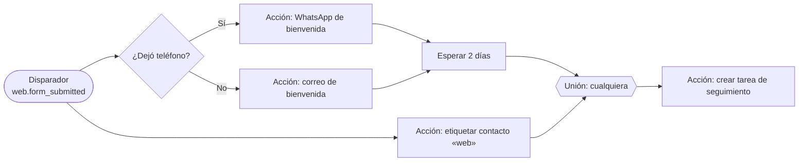

**Migración sin riesgo:** `linearToGraph(steps)` convierte cada flujo lineal en una cadena de nodos (`condition` sin rama «No» se completa con un nodo terminal implícito). La función se prueba contra las **19 plantillas existentes**: el grafo resultante debe producir el mismo recorrido y los mismos resultados que el motor lineal con los datos de ejemplo de cada plantilla. Mientras la bandera `AUTOMATION_ENGINE=v1|v2` está en `v1`, nada cambia.

#### 3.2.3 Motor de ejecución

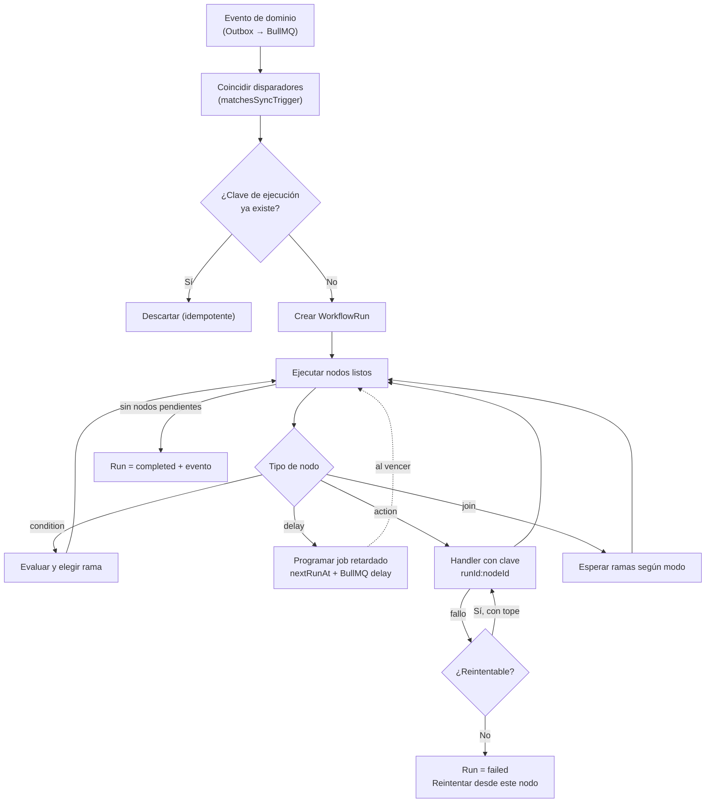

Reglas del motor (cada una resuelve un riesgo real de duplicado o pérdida):

1. **Clave de ejecución** `sha256(workflowId | triggerEventId | contactId)`. **Etapa 1 (sin migración):** guarda `SET NX EX 86400` en Redis. **Etapa 2 (Propuesta):** columna `WorkflowRun.idempotencyKey` con `@@unique([workflowId, idempotencyKey])`.
2. **Clave de acción** `runId:nodeId`: se pasa al canal de salida (correo, mensaje) y se registra antes de enviar; si el nodo se reintenta, no repite el efecto.
3. **Clasificación de efectos** (`ActionHandler.sideEffect`): `none` se puede simular, `external` envía algo al mundo, `costly` además gasta dinero (p. ej. `generate_image`). Las acciones `costly` consultan el tope antes de ejecutar.
4. **Esperas:** además de `nextRunAt`, se programa un *job* retardado en BullMQ (`queue: automation-runs`, `delay`). `run-due` queda como **barredor de seguridad** cada 5 minutos, no como mecanismo principal; así el retraso real de una espera es de segundos y no depende del sondeo.
5. **Reintento:** hasta 3 intentos con retroceso exponencial **solo** para errores de red/5xx/429 en acciones `none` o `external` idempotentes; las `costly` no se reintentan solas.
6. **Reanudar desde el nodo fallido:** `POST /api/automations/runs/{id}/retry` (cierra la deuda registrada). Crea intentos nuevos sobre el mismo `WorkflowRun`, conserva el contexto y salta los nodos ya completados.
7. **Protección contra bucles:** cada evento lleva `causationDepth`; una automatización disparada por otra automatización incrementa la profundidad; **máximo 5**, después el run termina con `LOOP_GUARD` visible en actividad.
8. **Horario silencioso y límites por canal:** respetan `Settings` y `automation-safety.ts` (ya existente); si un mensaje cae fuera de horario, el nodo se reprograma, no se descarta.
9. **Concurrencia:** `concurrency: 10` por worker y, por espacio, máximo 5 runs simultáneos para evitar que una importación masiva sature a los demás.

```typescript
// src/modules/automatizacion/application/execute-node.ts
export interface NodeOutcome {
  readonly next: ReadonlyArray<string>;      // ids de nodos a activar
  readonly wakeAt?: Date;                    // si es una espera
  readonly detail: string;                   // aparece en la pestaña Actividad
}

export async function executeNode(
  node: WorkflowNode,
  run: RunState,
  deps: { registry: ActionRegistry; conditions: ConditionEvaluator; clock: Clock; budget: BudgetGuard; log: Logger },
  signal: AbortSignal,
): Promise<NodeOutcome> {
  switch (node.kind) {
    case 'condition': {
      const { pass, detail } = deps.conditions.evaluate(node.check, run.context);
      return { next: run.graph.successors(node.id, pass ? 'true' : 'false'), detail };
    }
    case 'delay':
      return { next: run.graph.successors(node.id), wakeAt: deps.clock.addInterval(node.amount, node.unit), detail: `Espera ${node.amount} ${node.unit}` };
    case 'join':
      return run.joinReady(node) ? { next: run.graph.successors(node.id), detail: 'Ramas unidas' } : { next: [], detail: 'Esperando otras ramas' };
    case 'action': {
      const handler = deps.registry.resolve(node.type);
      if (handler.sideEffect === 'costly') await deps.budget.assertAvailable(run.workspaceId, handler.estimate?.(node.config));
      const result = await handler.execute(handler.configSchema.parse(node.config), { ...run.context, idempotencyKey: `${run.id}:${node.id}` }, signal);
      return { next: run.graph.successors(node.id), detail: result.detail };
    }
    case 'trigger':
      return { next: run.graph.successors(node.id), detail: 'Disparador aceptado' };
  }
}
```

El `switch` es **exhaustivo** (regla `switch-exhaustiveness-check`): añadir un tipo de nodo sin tratarlo rompe la compilación, no el runtime.

#### 3.2.4 Catálogo de disparadores y acciones nuevos (sinergias)

| Tipo | Identificador | Origen | Datos que entrega | Efecto |
|---|---|---|---|---|
| Disparador | `grid.completed` | Generador | `gridId`, `imageCount`, `costUsd` | `none` |
| Disparador | `web.form_submitted` | Sitios Web | `projectId`, `formId`, campos validados | `none` |
| Disparador | `media.tagged` | Multimedia | `mediaId`, etiqueta añadida | `none` |
| Acción | `generate_image` | Generador | `ImageJob` creado | `costly` |
| Acción | `schedule_grid_posts` | Generador + Marketing | `ScheduledPost[]` creados (respetando `IG_PUBLISH_MODE`) | `external` |
| Acción | `create_contact_from_form` | Sitios Web | `Contact` creado o actualizado por email | `none` |
| Acción | `attach_media` | Multimedia | `MediaRef` en el contexto del run | `none` |

La publicación real en Instagram sigue gobernada por `IG_PUBLISH_MODE` (valor por defecto simulado); esta arquitectura **no activa** el modo `live`.

#### 3.2.5 Constructor visual: experiencia y justificación técnica

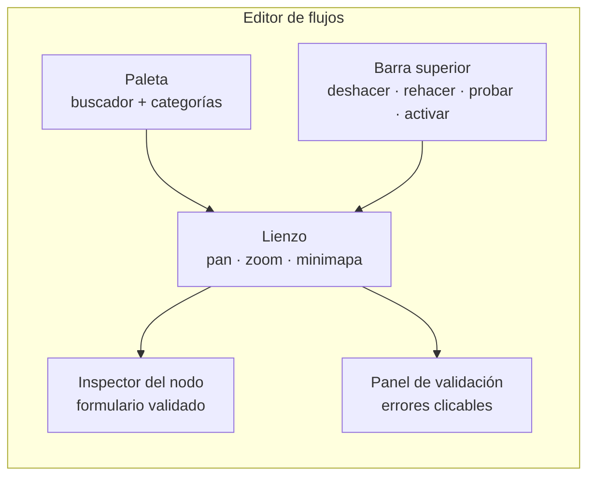

| Capacidad | Diseño | Justificación |
|---|---|---|
| **Lienzo** | `@xyflow/react` (MIT) cargado con `next/dynamic` solo en el editor | Resuelve pan/zoom, minimapa, conexiones y accesibilidad por teclado ya probados; escribirlo propio serían ~800 líneas de mantenimiento permanente. **Dependencia nueva: Propuesta** (ADR-008). Alternativa descartada: lienzo propio en SVG |
| **Minimapa y zoom** | Minimapa fijo abajo a la derecha (se oculta bajo 768 px), zoom 25–200 %, botón «Ajustar a pantalla» | Orientación en flujos de 30+ nodos |
| **Validación en vivo** | `validateGraph` en cada cambio (con *debounce* de 150 ms); los errores marcan el nodo con borde y un icono (no solo color), y el panel lista cada uno con «Ir al nodo» | Imposible activar un flujo inválido: el botón «Activar» queda deshabilitado con el motivo |
| **Deshacer / rehacer** | `createStore` (§2.3.3) con comandos por acción (mover, conectar, editar); arrastres fusionados con `mergeKey` | Un arrastre de 200 píxeles es **un** paso en el historial |
| **Autoguardado** | Borrador con *debounce* de 800 ms, `ETag`/`If-Match`; indicador «Guardado hace 3 s»; conflicto → diálogo «Ver cambios del otro usuario» | Cero pérdida de trabajo |
| **Probar sin riesgo** | «Ejecución de prueba» con datos de ejemplo del disparador: acciones `external`/`costly` se **simulan** y el resultado se pinta nodo por nodo | Confianza antes de activar; cero envíos reales |
| **Plantillas** | Las 19 plantillas existentes (`automation-templates.ts`, `automation-template-gallery.ts`) se abren ya como grafo, con los requisitos faltantes marcados | Del problema al flujo en < 1 minuto |
| **Teclado** | `Tab` recorre nodos; flechas los mueven en pasos de 8 px; `Enter` abre el inspector; `Supr` borra (con deshacer); `/` enfoca el buscador de la paleta | Accesibilidad y velocidad de personas expertas |
| **Móvil** | Bajo 768 px el lienzo pasa a **vista de lista** de pasos editable (el grafo es de solo lectura con zoom) | Cumple «100 % responsive» sin un lienzo inutilizable en pantalla táctil pequeña |
| **Actividad** | Pestaña existente (servidor + CSV) con enlace «Ver en el lienzo» que resalta el recorrido de cada run | Depuración visual |

#### 3.2.6 Pruebas

Dominio: `validateGraph` (un caso por cada `GraphIssue.code`), `linearToGraph` frente a las 19 plantillas, `matchesSyncTrigger`. Aplicación: `executeNode` para cada tipo con relojes y presupuestos simulados; idempotencia (mismo evento dos veces → un run); reintento desde nodo fallido; guarda de bucles. Integración: Redis real para `SET NX` y jobs retardados. E2E (ya existe `scripts/e2e-automations.ts` como base): crear un flujo desde plantilla, ejecutar la prueba y activar.

#### 3.2.7 Riesgos

| Riesgo | Mitigación |
|---|---|
| Ejecuciones duplicadas por reentrega de eventos | Clave de ejecución + clave de acción (dos barreras) |
| Mensajes fuera de horario o spam involuntario | `automation-safety.ts` + horario silencioso + simulación obligatoria antes de la primera activación |
| Flujo antiguo que se comporta distinto en el motor nuevo | Bandera `AUTOMATION_ENGINE`, pruebas de equivalencia con las 19 plantillas y activación gradual por espacio |
| Planificador de `run-due` no configurado | La fase 2 deja el sondeo como barredor y documenta el disparador por entorno; sin él, las esperas siguen funcionando por jobs retardados |

---

### 3.3 Contenido Multimedia

#### 3.3.1 Estado actual y brecha

| Aspecto | Hoy | Brecha |
|---|---|---|
| Fuente de datos | `GET /api/media` agrega imágenes del Generador (`ContentGridAsset`), salidas de campañas (`Asset`), medios de `ScheduledPost.mediaUrls` y el documento de marca; caché de servidor de 20 s | No existe el concepto de **activo propio**: no hay tamaño, etiquetas compartidas ni subida |
| Subida | No existe (decisión pendiente en `docs/DECISION-ALMACENAMIENTO-MULTIMEDIA.md`) | Sin biblioteca utilizable para sitios web ni para equipos |
| Etiquetas y vistas guardadas | En el navegador de cada persona (`media-local.ts`) | No se comparten con el equipo; se pierden al cambiar de dispositivo |
| Cuotas | Imposible (ningún modelo guarda `sizeBytes`) | Sin indicador de espacio ni límites por plan |
| Variantes optimizadas | No hay | Se sirven originales pesados en cuadrículas |

> **Decisión que corresponde a Reiner.** El documento `DECISION-ALMACENAMIENTO-MULTIMEDIA.md` ofrece tres opciones. Esta arquitectura asume la **opción 1 (modelo `MediaAsset` + R2 con URL firmadas)** porque reutiliza `r2.ts`, habilita cuotas y es la única que permite que los Sitios Web referencien activos de forma estable. Hasta que Reiner la apruebe, **nada de lo marcado como Propuesta se implementa**, y el módulo sigue como agregador de solo lectura.

#### 3.3.2 Arquitectura objetivo

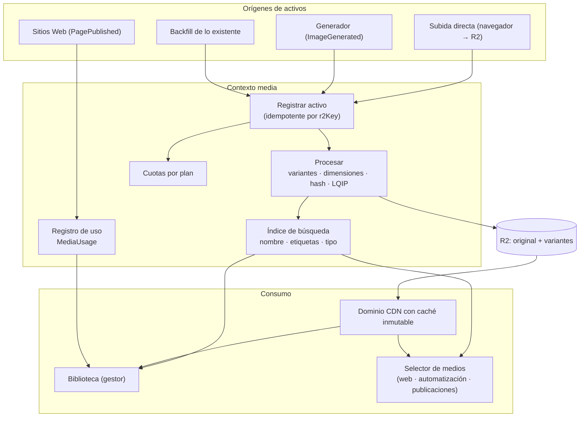

#### 3.3.3 Modelo de datos (**Propuesta**)

```prisma
model MediaAsset {
  id              String    @id @default(cuid())
  workspaceId     String
  kind            String    // image | video | audio | document
  name            String
  altText         String?
  caption         String?
  mime            String
  sizeBytes       BigInt
  width           Int?
  height          Int?
  durationSec     Float?
  sha256          String    // detecta duplicados dentro del espacio
  r2Key           String
  visibility      String    @default("private") // private | public
  blurhash        String?   // marcador de posición instantáneo
  source          String    @default("upload") // upload | generator | web | import
  sourceRef       String?   // id de ImageJob, ContentGridAsset, etc.
  tags            String[]  @default([])
  processStatus   String    @default("pending") // pending | ready | failed
  createdByUserId String?
  deletedAt       DateTime? // papelera: se purga a los 30 días
  createdAt       DateTime  @default(now())
  updatedAt       DateTime  @updatedAt

  workspace Workspace      @relation(fields: [workspaceId], references: [id])
  variants  MediaVariant[]
  usages    MediaUsage[]

  @@unique([workspaceId, r2Key])
  @@unique([workspaceId, sha256, deletedAt])
  @@index([workspaceId, createdAt])
  @@index([workspaceId, kind])
  @@index([workspaceId, deletedAt])
}

model MediaVariant {
  id        String   @id @default(cuid())
  assetId   String
  label     String   // thumb | sm | md | lg | poster
  format    String   // webp | avif | jpeg
  width     Int
  height    Int
  sizeBytes Int
  r2Key     String
  createdAt DateTime @default(now())

  asset MediaAsset @relation(fields: [assetId], references: [id], onDelete: Cascade)

  @@unique([assetId, label, format])
}

model MediaUsage {
  id         String   @id @default(cuid())
  assetId    String
  entityType String   // web_page | scheduled_post | workflow | brand
  entityId   String
  createdAt  DateTime @default(now())

  asset MediaAsset @relation(fields: [assetId], references: [id], onDelete: Cascade)

  @@unique([assetId, entityType, entityId])
  @@index([entityType, entityId])
}
```

Notas de diseño: las **etiquetas** son `String[]` con índice GIN (creado en SQL de la migración) en lugar de una tabla de unión: el etiquetado masivo es una sola sentencia `UPDATE … SET tags = array_cat(…)`, sin *joins*. La **búsqueda por nombre** usa `pg_trgm` (extensión de Postgres disponible en Supabase) con un índice GIN sobre `name`. `sha256` + `deletedAt` en la restricción única evita duplicados vigentes sin impedir volver a subir algo que está en la papelera.

**Estrategia de migración (expand → backfill → switch → contract):**

1. *Expand:* crear las tres tablas e índices (aditivo, sin tocar las existentes).
2. *Backfill:* `scripts/backfill-media.mjs` recorre `ContentGridAsset`, `Asset` y `ScheduledPost.mediaUrls`, registra los activos de forma idempotente (clave `r2Key`), con modo `--dry-run` por defecto y un informe de cuántos creará.
3. *Switch:* bandera `MEDIA_SOURCE=assets` por espacio; mientras sea `aggregate`, `/api/media` conserva el comportamiento actual.
4. *Contract:* cuando todos los espacios estén en `assets` durante 2 semanas sin incidentes, el agregador se retira.

#### 3.3.4 Subida directa a R2 (el archivo nunca pasa por la función)

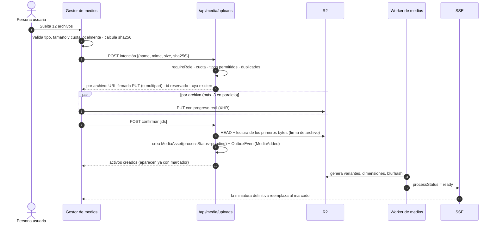

| Control | Regla (valores de la propuesta de la decisión de almacenamiento, sujetos a aprobación) |
|---|---|
| Tipos permitidos | Imágenes `jpeg`, `png`, `webp`, `gif`, `avif`; video `mp4`, `webm`; audio `mp3`, `wav`, `m4a`; documentos `pdf`. **Se excluye SVG** (vector de XSS) hasta contar con saneamiento dedicado |
| Verificación real | Se comprueba la **firma de archivo** (bytes iniciales) en el servidor; la extensión y el `Content-Type` del cliente no se confían |
| Tamaños máximos | Imágenes 10 MB · video 200 MB · documentos 25 MB; subida *multipart* a partir de 50 MB |
| Cuota por plan | Planes de 34/49/67 USD: los topes en GB los fija Reiner (ADR-007); el servidor suma `sizeBytes` de activos no eliminados; al 90 % la interfaz avisa, al 100 % bloquea nuevas subidas (no el uso de las existentes) |
| URL firmadas | Vigencia de subida 10 minutos; de descarga privada 1 hora (`getDownloadUrl`); activos `public` se sirven por el dominio CDN |
| Duplicados | Mismo `sha256` en el espacio → se ofrece «usar el existente» |
| Video | En la primera versión, el **póster se captura en el navegador** (canvas) antes de subir y se sube como `MediaVariant poster`; así no se requiere instalar `ffmpeg` en el worker. La transcodificación queda fuera de alcance y se documenta como límite conocido |

#### 3.3.5 Procesamiento y entrega en el borde

| Decisión | Elección | Alternativa descartada y por qué |
|---|---|---|
| Variantes | Pre-generadas por el worker al subir: `thumb` 320, `sm` 640, `md` 1280, `lg` 2048 en `webp` (+ `avif` para `md`/`lg`) con `sharp` | *Transformación al vuelo* en el borde (Cloudflare Images): excelente, pero añade un costo por transformación y dependencia de zona; se evalúa en la fase 4 con datos reales |
| Nombres | Clave por contenido (`{workspaceId}/{sha256}/{label}.{ext}`) → URLs **inmutables** | Claves aleatorias: impiden caché eterna |
| Caché | `Cache-Control: public, max-age=31536000, immutable` en activos públicos y variantes | Caché corta: más tráfico al origen sin beneficio |
| Dominio | Dominio personalizado de R2 con CDN de Cloudflare delante | Servir desde la URL de R2 directa: sin caché de borde |
| Marcador | `blurhash` de 4×3 componentes decodificado en cliente a un `<canvas>` de 32×32 escalado (sin `filter: blur`) | Miniatura borrosa por CSS: viola la regla de no usar desenfoque |
| Dependencias nuevas | `sharp` (procesamiento) y `blurhash` (marcador). **Propuesta** | Procesar en el navegador: inconsistente entre dispositivos |

> Nota de despliegue: el procesamiento corre en el **worker BullMQ**, no en las funciones de Vercel (que tienen límites de memoria y tiempo). Dónde se ejecuta el worker de forma persistente es una decisión operativa de la fase 2 (§4.2).

#### 3.3.6 Gestor de medios: experiencia

| Elemento | Diseño | Justificación técnica |
|---|---|---|
| **Cuadrícula virtualizada** | Solo se montan las celdas visibles (`@tanstack/react-virtual`, **Propuesta**) con altura de fila estable; miniaturas `loading="lazy"`, `decoding="async"`, `width`/`height` explícitos y `content-visibility: auto` | Miles de activos con DOM constante; CLS = 0 |
| **Búsqueda instantánea** | Caja siempre visible (`/` la enfoca). Filtra en el cliente el índice ligero ya cargado `{id, name, tags, kind, thumb}` y, pasados 150 ms, consulta el servidor (`pg_trgm`) para lo que no está cargado. Operadores: `tipo:imagen`, `etiqueta:logo`, `de:generador`, `uso:ninguno`, `mayor:5mb` | Respuesta percibida < 100 ms sin ida y vuelta por tecla |
| **Selección múltiple** | Clic, `Shift`+clic para rangos, `Ctrl/Cmd`+clic, rectángulo de arrastre y «Seleccionar todo lo filtrado» | Patrón conocido de gestores de archivos |
| **Barra de acciones masivas** | Aparece fija al seleccionar: Etiquetar · Quitar etiqueta · Mover a colección · Descargar (ZIP en cliente hasta 100 MB) · Eliminar | Una sola sentencia SQL por acción masiva (`UPDATE … WHERE id = ANY($1)`) |
| **Etiquetado masivo** | Campo con autocompletado de etiquetas existentes; crear escribiendo y `Enter`; chips con `×` | Etiquetas normalizadas (minúsculas, sin tildes, sin duplicados) por una función pura probada |
| **Metadatos en línea** | Panel lateral derecho (en móvil, hoja inferior) con nombre, texto alternativo, descripción y etiquetas editables; **guarda al salir del campo** con actualización optimista y reversión (§2.3.2); indicador «Guardado» | Cero botones «Guardar» |
| **Texto alternativo asistido** | Botón «Sugerir con IA» (acción `costly` explícita, con precio visible) | Accesibilidad de los sitios web desde el origen |
| **Eliminar con deshacer** | Borrado suave (`deletedAt`); toast de 8 s con «Deshacer»; papelera con purga automática a los 30 días | Nunca un borrado irreversible por error. Si el activo está en uso, el diálogo lista dónde (`MediaUsage`) |
| **Arrastrar para subir** | Capa de soltar a pantalla completa; también pegar desde el portapapeles (`Ctrl/Cmd`+`V`) | Menos pasos |
| **Colecciones y vistas guardadas** | Guardadas en servidor por espacio (reemplazan al `localStorage` actual de `media-local.ts`; se importan una vez al primer acceso) | Compartido con el equipo y portable |
| **Indicador de espacio** | Barra «3,2 GB de 10 GB» con desglose por tipo; aviso al 90 % | Cuotas claras, sin sorpresas |
| **Estados** | Carga con `Skeleton`; vacío con `EmptyState` y botón «Subir» o «Generar con IA»; error con «Reintentar» por archivo | Los cuatro estados de §2.5.4 |
| **Teclado y lectores de pantalla** | Cuadrícula con *roving tabindex*, `aria-selected`, flechas para moverse, `Espacio` para vista previa, `Supr` para borrar, `Esc` para salir | Accesible y rápido |

**Selector de medios (pieza compartida):** el mismo componente de la biblioteca, en modo selección, se abre como diálogo desde el editor web, desde acciones de automatización (`attach_media`) y desde la programación de publicaciones. Devuelve un `MediaRef` `{ assetId, variant? }`, **nunca una URL**. Beneficio: si el activo se reemplaza, se actualiza en todos los usos; si se intenta borrar, se avisa dónde está.

```typescript
// src/kernel/media-ref.ts — objeto de valor del núcleo compartido
import { z } from 'zod';

export const MediaRefSchema = z.object({
  assetId: z.string().min(1),
  variant: z.enum(['thumb', 'sm', 'md', 'lg', 'original']).default('md'),
});
export type MediaRef = z.infer<typeof MediaRefSchema>;

export interface MediaResolver {
  /** Resuelve a una URL servible (CDN si es pública; firmada si es privada) con dimensiones para evitar CLS. */
  resolve(ref: MediaRef, workspaceId: string): Promise<{ url: string; width: number; height: number; blurhash?: string; alt?: string }>;
}
```

#### 3.3.7 Contratos principales

| Método y ruta | Propósito | Notas |
|---|---|---|
| `GET /api/media?cursor&limit&q&kind&tag&collection` | Listado paginado por cursor | `ETag`; caché de servidor corta; devuelve el índice ligero |
| `POST /api/media/uploads` | Intención de subida (lote) | Devuelve URL firmadas, duplicados y cuota restante |
| `POST /api/media/uploads/confirm` | Confirma lo subido | Verifica `HEAD` y firma de archivo |
| `PATCH /api/media/{id}` | Metadatos en línea | `If-Match` obligatorio |
| `POST /api/media/bulk` | Acciones masivas | Cuerpo `{ ids, action: 'tag' | 'untag' | 'trash' | 'restore' | 'move', payload }`; devuelve resumen por id |
| `GET /api/media/{id}/usage` | Dónde se usa | Alimenta el diálogo de borrado |
| `GET /api/media/quota` | Espacio usado y límite | Alimenta el indicador |

#### 3.3.8 Pruebas y riesgos

Dominio: normalización de etiquetas, cálculo de cuota, transiciones de papelera. Aplicación: confirmar subida (firma de archivo inválida, tipo no permitido, cuota excedida, duplicado). Contrato: adaptador de R2 con un servidor S3 simulado. E2E: «subir 3 imágenes, etiquetarlas en bloque y usarlas en una página». Riesgos: **XSS por archivo subido** (mitigado: sin SVG, verificación de firma, `Content-Disposition` y tipo servidos desde el dominio de activos, separado del origen de la aplicación); **costo de almacenamiento** (cuotas + purga de papelera); **migración del `localStorage`** (importación única con confirmación).

---

### 3.4 Sitios Web

#### 3.4.1 Alcance y nomenclatura

El módulo actual `/sitios` administra **Sedes** (modelo `Site`: hotel, restaurante, oficina, local). Se conserva sin cambios y gana un papel nuevo: ser la **fuente de datos estructurados** de los sitios web (nombre, dirección, teléfono, coordenadas, capacidad → JSON-LD, mapa y bloque de reservas). El **constructor de páginas** es el contexto nuevo `web`.

| Concepto | Nombre en la interfaz | Modelo | Estado |
|---|---|---|---|
| Propiedad física | **Sedes** | `Site` (existente) | Sin cambios |
| Sitio web | **Sitios web** | `WebProject` | Propuesta |
| Página | **Páginas** | `WebPage` | Propuesta |
| Versión publicada | **Versiones** | `WebPageVersion` | Propuesta |
| Dominio propio | **Dominios** | `WebDomain` | Propuesta |

#### 3.4.2 Arquitectura objetivo

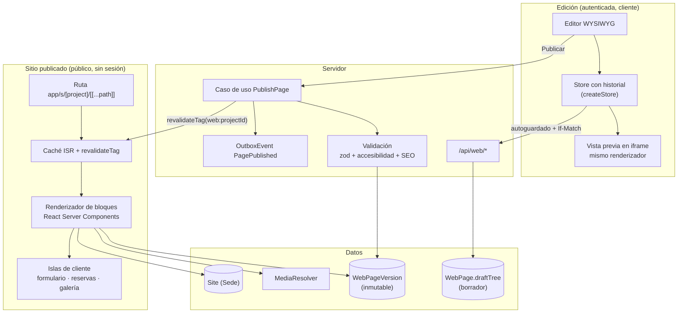

**Principio de fidelidad WYSIWYG:** el editor y el sitio publicado usan **el mismo renderizador de bloques** (componentes React puros que reciben `props` validadas). Lo que se ve en el lienzo es lo que se publica, porque es el mismo código, no una réplica.

#### 3.4.3 Modelo de datos (**Propuesta**)

```prisma
model WebProject {
  id            String   @id @default(cuid())
  workspaceId   String
  siteId        String?  // Sede asociada (datos estructurados y reservas)
  name          String
  slug          String   @unique
  defaultLocale String   @default("es")
  tokens        Json     @default("{}") // sobreescrituras de los design tokens
  status        String   @default("draft") // draft | published | archived
  createdAt     DateTime @default(now())
  updatedAt     DateTime @updatedAt

  workspace Workspace   @relation(fields: [workspaceId], references: [id])
  pages     WebPage[]
  domains   WebDomain[]

  @@index([workspaceId])
}

model WebPage {
  id                 String   @id @default(cuid())
  projectId          String
  path               String   // «/» · «/habitaciones» · «/blog/hola»
  title              String
  seo                Json     @default("{}") // {description, ogMediaRef, noindex}
  draftTree          Json     // árbol de bloques en edición
  draftRevision      Int      @default(0) // ETag / control optimista
  publishedVersionId String?
  updatedByUserId    String?
  createdAt          DateTime @default(now())
  updatedAt          DateTime @updatedAt

  project  WebProject       @relation(fields: [projectId], references: [id], onDelete: Cascade)
  versions WebPageVersion[]

  @@unique([projectId, path])
  @@index([projectId])
}

model WebPageVersion {
  id          String    @id @default(cuid())
  pageId      String
  tree        Json      // inmutable
  tokensHash  String
  checksum    String    // sha256 del árbol: evita publicar duplicados
  note        String?
  publishedAt DateTime?
  createdBy   String?
  createdAt   DateTime  @default(now())

  page WebPage @relation(fields: [pageId], references: [id], onDelete: Cascade)

  @@index([pageId, createdAt])
}

model WebDomain {
  id         String    @id @default(cuid())
  projectId  String
  hostname   String    @unique
  status     String    @default("pending") // pending | verified | active | error
  verifiedAt DateTime?
  createdAt  DateTime  @default(now())

  project WebProject @relation(fields: [projectId], references: [id], onDelete: Cascade)

  @@index([projectId])
}
```

El formulario del sitio **no necesita tabla propia**: cada envío crea o actualiza un `Contact` (modelo existente), con nota (`Note`) del origen y la bandera de consentimiento, y emite `FormSubmitted` para que las automatizaciones reaccionen.

#### 3.4.4 Modelo de bloques

```typescript
// src/modules/web/domain/blocks.ts
import { z } from 'zod';

export const Breakpoint = z.enum(['base', 'md', 'lg']); // móvil primero
const Responsive = <T extends z.ZodTypeAny>(schema: T) =>
  z.object({ base: schema, md: schema.optional(), lg: schema.optional() });

export const MediaRefSchema = z.object({ assetId: z.string(), variant: z.enum(['thumb', 'sm', 'md', 'lg', 'original']).default('lg') });

const Common = {
  id: z.string().min(1).max(40),
  hidden: z.record(Breakpoint, z.boolean()).optional(),
  anchor: z.string().regex(/^[a-z0-9-]{1,40}$/).optional(),
};

export const HeroBlock = z.object({
  ...Common, type: z.literal('hero'),
  props: z.object({
    heading: z.string().min(1).max(120),
    subheading: z.string().max(240).optional(),
    media: MediaRefSchema.optional(),
    alt: z.string().max(160).optional(),
    align: Responsive(z.enum(['start', 'center'])),
    cta: z.object({ label: z.string().max(40), href: z.string().max(400) }).optional(),
  }),
});

export const FormBlock = z.object({
  ...Common, type: z.literal('form'),
  props: z.object({
    formId: z.string().regex(/^[a-z0-9-]{1,40}$/),
    fields: z.array(z.object({ name: z.string(), label: z.string(), kind: z.enum(['text', 'email', 'tel', 'textarea', 'select', 'consent']), required: z.boolean().default(false) })).min(1).max(12),
    successMessage: z.string().max(240),
  }),
});

// RichText, Image, Gallery, Button, Columns, Booking (Sede), Map (Sede), Faq, Footer…
export type PageNode = z.infer<typeof HeroBlock> | z.infer<typeof FormBlock> | ContainerNode; // unión completa en el registro de bloques

export interface ContainerNode {
  readonly id: string;
  readonly type: 'section' | 'columns';
  readonly props: Record<string, unknown>;
  readonly children: ReadonlyArray<PageNode>;
}
```

Cada tipo de bloque se registra una sola vez (`BlockRegistry`) con: esquema de `props`, componente de **renderizado**, componente de **inspector**, vista previa de la paleta y reglas de accesibilidad. Añadir un bloque es registrar, no editar el editor (principio abierto/cerrado, §2.1).

#### 3.4.5 Design tokens (sistema de diseño de los sitios)

Los tokens se **derivan de la marca** (`Workspace.brandProfile`) y se pueden sobreescribir por proyecto (`WebProject.tokens`). Se emiten como variables CSS en una etiqueta `<style>` en línea (sin petición adicional) con espacio de nombres `--web-*`, separado de los `--rai-*` de la aplicación.

```json
{
  "color": {
    "brand":   { "50": "#fdf6ec", "500": "#b8741a", "700": "#7a4a10" },
    "surface": { "base": "#ffffff", "raised": "#f7f4ef" },
    "text":    { "default": "#1d1a16", "muted": "#5c554b", "onBrand": "#ffffff" }
  },
  "font": {
    "heading": { "family": "'Fraunces', serif", "weights": [600, 700] },
    "body":    { "family": "'Inter', system-ui, sans-serif", "weights": [400, 600] },
    "scale":   { "base": 1, "ratio": 1.2 }
  },
  "space": { "unit": 4, "scale": [0, 1, 2, 3, 4, 6, 8, 12, 16] },
  "radius": { "sm": 4, "md": 8, "lg": 16 },
  "breakpoint": { "md": 768, "lg": 1200 }
}
```

```css
/* salida generada (ejemplo) */
:root {
  --web-color-brand-500: #b8741a;
  --web-color-surface-base: #ffffff;
  --web-font-heading: 'Fraunces', serif;
  --web-step-0: 1rem;
  --web-step-1: 1.2rem;
  --web-step-2: 1.44rem;
  --web-radius-md: 8px;
}
@media (min-width: 768px)  { :root { --web-gutter: 32px; } }
@media (min-width: 1200px) { :root { --web-gutter: 48px; } }
```

Reglas: la **elevación se expresa con borde y color de superficie**, nunca con desenfoque (`filter`, `backdrop-filter`); la escala tipográfica es fluida con `clamp()`; **el contraste AA (4,5:1 texto normal, 3:1 texto grande) se calcula al guardar** los tokens y bloquea la publicación si una combinación de marca lo incumple, sugiriendo el tono más cercano que sí cumple.

#### 3.4.6 Editor WYSIWYG: experiencia y justificación técnica

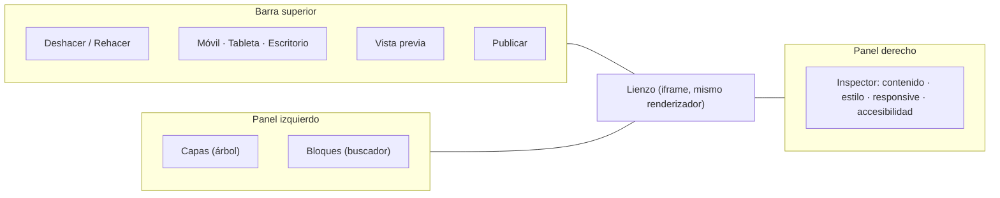

| Capacidad | Diseño | Justificación técnica |
|---|---|---|
| **Lienzo en iframe** | El lienzo es un `<iframe>` con el mismo renderizador; el ancho del iframe cambia entre 390, 768 y 1280 px | Los *media queries* reales responden al ancho del iframe, no de la ventana: la edición responsive es **fiel** |
| **Edición responsive** | Cada propiedad con variante por punto de corte muestra un indicador «base / md / lg»; editar en «md» crea una sobreescritura que se puede restablecer. Diseño móvil primero | Esquema `Responsive<T>` (§3.4.4) |
| **Texto en línea** | Edición directa sobre el lienzo con TipTap (ProseMirror) limitado a negrita, cursiva, enlace, lista y encabezado; el HTML se **sanea con lista blanca** al guardar. **Dependencia nueva: Propuesta** (`@tiptap/react`, carga diferida) | Edición real in situ; evita pegar HTML arbitrario |
| **Arrastrar y soltar** | Desde la paleta al lienzo y entre bloques, con indicador de posición de soltado; alternativa por teclado («Mover arriba/abajo», «Insertar después») y táctil (mantener pulsado). `@dnd-kit/core` con sensores de puntero, teclado y táctil (**Propuesta**) | Accesibilidad como requisito, no como extra |
| **Deshacer / rehacer** | `createStore` (§2.3.3); comandos tipados (`InsertNode`, `MoveNode`, `UpdateProps`, `RemoveNode`); escritura y arrastre fusionados con `mergeKey`; límite de 200 pasos; atajos `Ctrl/Cmd`+`Z` y `Shift`+`Z` | Un editor sin deshacer fiable no es utilizable |
| **Autoguardado** | Cada 1 s tras el último cambio: `PUT /api/web/pages/{id}/draft` con `If-Match: draftRevision`; estado visible «Guardando… / Guardado / Sin conexión (se reintentará)» | Cero pérdida; conflicto → diálogo con opción de recargar o sobrescribir |
| **Selector de medios** | El bloque Imagen abre el selector compartido (§3.3.6) y guarda `MediaRef`; muestra el texto alternativo almacenado en el activo | Una sola fuente de imágenes y de texto alternativo |
| **Comprobaciones en vivo** | Panel «Revisión»: encabezados en orden, imágenes sin texto alternativo, contraste, enlaces rotos internos, meta descripción, tamaño de página estimado | La calidad se corrige mientras se edita, no al publicar |
| **Versiones** | Línea de tiempo de versiones publicadas; «Comparar» (diferencia de árboles) y «Restaurar como borrador»; **reversión = republicar una versión anterior** en un clic | La publicación es segura porque deshacerla es trivial |
| **Estados** | `Skeleton` del editor mientras carga; `EmptyState` en proyectos sin páginas con plantillas iniciales (Hotel, Restaurante, Oficina, Una página) alimentadas por los datos de la Sede | Primer sitio publicable en minutos |
| **Atajos** | `Ctrl/Cmd`+`K` paleta de comandos (insertar bloque, ir a página, publicar), `Ctrl/Cmd`+`S` forzar guardado, `Supr`, `Ctrl/Cmd`+`D` duplicar | Velocidad para quien edita a diario |
| **Responsive del propio editor** | Bajo 1024 px los paneles laterales pasan a cajones; bajo 768 px el editor ofrece edición por lista de bloques con vista previa | El propio producto cumple «100 % responsive» |

#### 3.4.7 Publicación y renderizado (SSG / ISR / SSR)

| Tipo de contenido | Estrategia | Razón |
|---|---|---|
| Páginas publicadas (texto, imágenes, secciones) | **Estáticas con ISR**: `generateStaticParams` para las rutas de proyectos activos; `revalidate` bajo y **revalidación a demanda** con `revalidateTag('web:{projectId}')` al publicar | Tiempo de respuesta de borde, costo mínimo y actualización inmediata tras publicar |
| Formulario de contacto | **Isla de cliente** que envía a `POST /api/public/web/forms/{projectId}/{formId}` (rate-limit + honeypot + consentimiento) | Hidratación solo donde hay interacción |
| Bloque de reservas | Isla que usa `/api/public/booking` existente de la Sede | Reutiliza un contrato ya probado |
| Vista previa del borrador | **SSR** autenticado (sin caché) | Debe reflejar el último cambio |
| Páginas con datos de tiempo real (disponibilidad) | **SSR** en la isla, nunca en la página completa | Evita volver dinámica toda la página |

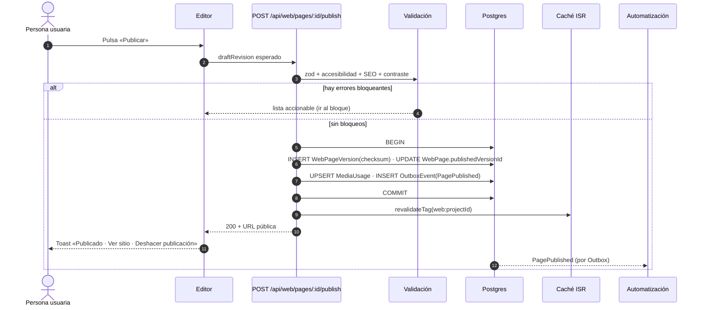

**Dominios propios:** ruta de resolución por host. Hoy el proyecto **no tiene `middleware.ts`**; introducirlo afecta a toda petición, por lo que se propone una versión mínima con `matcher` restringido a dominios no pertenecientes a la aplicación y que solo reescribe a `/s/{project}`. Verificación de dominio por registro DNS TXT; certificado a cargo de Vercel. Esta pieza requiere un **token de la API de Vercel** (secreto que gestiona Reiner, nunca se escribe en el repositorio) y queda **al final de la fase 3**, tras validar todo lo demás con el subdominio de la plataforma (ADR-009, Propuesta).

#### 3.4.8 Rendimiento del sitio publicado

| Palanca | Medida |
|---|---|
| JavaScript | Bloques estáticos son *Server Components*: **0 KB** de JS; solo las islas hidratan (`next/dynamic`) |
| Imágenes | `srcset` desde `MediaVariant` (`webp`/`avif`), `width`/`height` siempre, `fetchpriority="high"` solo en la imagen de LCP, marcador `blurhash` |
| Fuentes | Alojadas en el propio dominio (subconjuntos latinos), `font-display: swap`, precarga de la fuente del título |
| CSS | Tokens en línea + CSS de bloques con el HTML (sin hoja externa bloqueante) |
| Caché | `s-maxage` largo + `stale-while-revalidate`; HTML estático en el borde |
| Objetivos | LCP ≤ 2,0 s (p75 móvil, red 4G), INP ≤ 200 ms, CLS ≤ 0,05, peso inicial ≤ 150 KB sin imágenes (§4.5) |

#### 3.4.9 Seguridad y cumplimiento

- **Sin scripts arbitrarios** en la primera versión (no hay bloque «Código personalizado»); el texto enriquecido se sanea con lista blanca; los enlaces `javascript:` se rechazan en el esquema.
- **CSP estricta** en el sitio publicado (`default-src 'self'`, imágenes del dominio de activos, sin `unsafe-inline` para scripts).
- **Formularios:** *honeypot*, límite de tasa por IP y por proyecto, validación de `zod`, casilla de **consentimiento obligatoria** registrada en la nota del contacto. Un CAPTCHA externo (p. ej. Turnstile) se evalúa solo si el spam lo justifica y con aprobación; no se evade ninguna verificación de bots.
- **Aislamiento multi-tenant:** toda consulta incluye `workspaceId` derivado de la sesión en el editor; en el sitio público se resuelve por `slug`/`hostname` y solo se lee contenido **publicado**.
- **SEO técnico:** `generateMetadata`, `sitemap.xml` y `robots.txt` por proyecto, `canonical`, Open Graph desde `seo.ogMediaRef`, y **JSON-LD** (`Hotel`, `Restaurant`, `LocalBusiness`) generado desde la Sede asociada.

#### 3.4.10 Pruebas y riesgos

Dominio: esquemas de bloques (un caso válido e inválido por tipo), comandos del editor (aplicar/revertir son inversos), cálculo de contraste, reglas de publicación. Aplicación: `PublishPage` (atómico: si falla `MediaUsage`, no hay versión), control optimista (`412`), idempotencia por `checksum`. Componentes: renderizador de bloques en los tres anchos. E2E: crear sitio desde plantilla de Hotel, editar, publicar, abrir URL pública y enviar el formulario (verifica el contacto creado y el disparo de la automatización de bienvenida). Lighthouse CI sobre una página publicada de referencia.

| Riesgo | Mitigación |
|---|---|
| Alcance del editor (el módulo más grande) | Entrega por incrementos verticales (§4.3): primero publicar una página de texto e imágenes; después bloques, después dominios propios |
| Divergencia editor/publicado | Mismo renderizador + prueba de captura visual comparando ambos |
| Pérdida de contenido por conflictos | `draftRevision` + `If-Match` + versiones inmutables |
| Dominios propios (middleware global) | Última entrega, matcher mínimo, con salida de emergencia por bandera |

---

### 3.5 Consistencia transversal entre los cuatro módulos

La cohesión no depende de la buena voluntad: depende de **componentes y contratos compartidos** que los cuatro módulos *deben* usar.

| Pieza compartida | Ubicación | La usan | Qué garantiza |
|---|---|---|---|
| `JobTray` (bandeja de trabajos del encabezado) | `src/app/_shell/` | Generador, Automatización (pruebas y runs), Multimedia (procesamiento), Web (publicación) | Todo trabajo largo se ve y se cancela en un solo lugar |
| `MediaPicker` | `src/app/_shared/media/` | Web, Automatización, Marketing, Generador | Una sola forma de elegir imágenes |
| `Toast` + catálogo de mensajes por `ErrorCode` | `src/kernel/client/` | Todos | Mismo tono y mismas acciones ante el mismo error |
| `ConfirmDestructive` con deshacer | `src/app/_shared/` | Todos | Ninguna acción destructiva sin red de seguridad |
| `Skeleton`, `EmptyState`, `PageSkeleton` | existentes | Todos | Cuatro estados de interfaz homogéneos |
| `useCachedJson`, `mutateOptimistic`, `invalidate` | existentes + `kernel` | Todos | Mismo comportamiento de carga y actualización |
| `useJobProgress` | `src/kernel/client/` | Todos los que tengan trabajos | Mismo canal SSE y mismas reconexiones |
| `Inspector` (panel lateral/hoja inferior) | `src/app/_shared/` | Editor de flujos, editor web, gestor de medios | Un patrón de edición de propiedades |
| `createStore` (historial) | `src/kernel/client/` | Editor de flujos, editor web | Deshacer/rehacer idéntico |
| Tokens `--rai-*` y `effects.css` | existentes | Todos | Aspecto premium sin saturación, sin desenfoque |
| `withApi`, `AppError`, `ApiProblem`, `Page<T>` | `src/kernel/http/` | Todas las rutas nuevas | Mismo contrato de respuesta y de error |
| `logAudit` | existente | Toda escritura | Trazabilidad uniforme |

**Matriz de coherencia de experiencia** (se revisa en cada pull request que toque un módulo):

| Criterio | Verificación |
|---|---|
| Cuatro estados (carga/vacío/error/éxito) | Existe prueba de componente para cada uno |
| Acción destructiva reversible | Hay toast con «Deshacer» o confirmación con consecuencias |
| Trabajo largo no bloquea | Aparece en `JobTray` y sobrevive a la navegación |
| Responsive 320–1440 px | Captura a 320, 768 y 1440 px adjunta al cambio |
| Sin desenfoque y con movimiento reducido | `scripts/rules-guard.mjs` en verde |
| Teclado completo | Recorrido con `Tab` documentado en la prueba E2E |
| Costo visible antes de gastar | Precio mostrado en toda acción `costly` |

---

## 4. Hoja de ruta de implementación

### 4.1 Visión general en cuatro fases

Las fechas son **estimaciones de planificación** para un desarrollador principal asistido por agentes, y dependen de las aprobaciones marcadas como compuertas (◆). Nada de lo marcado como Propuesta empieza sin la aprobación explícita de Reiner.

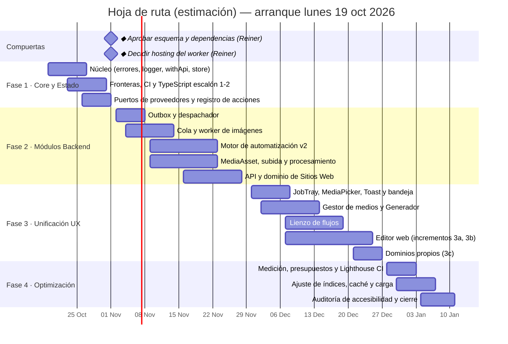

Cada fase termina con un **corte verificable**: puertas de §2.5.1 en verde, documentación al día, demostración de un recorrido completo en staging y registro en `docs/planning/roadmap-agentes-rai.html`.

### 4.2 Fase 1 — Core y Estado (≈ 2 semanas)

**Objetivo:** que cada módulo posterior se construya sobre los mismos cimientos. No cambia el comportamiento visible; reduce el riesgo de todo lo demás.

| ID | Entrega | Criterio de aceptación (medible) |
|---|---|---|
| 1.1 | `src/kernel/`: `AppError`, `ERROR_CODES`, `toProblem`, `withApi`, `ApiSuccess`, `Page<T>`, `createLogger` | Las rutas nuevas y las 6 con más tráfico migradas devuelven `application/problem+json`; pruebas del catálogo completo |
| 1.2 | Cliente: `createStore`, `mutateOptimistic`, `useJobProgress`, `Toast` con catálogo por `ErrorCode` | Cobertura ≥ 90 % del kernel; story de cada variante de toast |
| 1.3 | Fronteras entre contextos: reglas ESLint + `dependency-cruiser`; estructura `src/modules/*` creada con los puertos vacíos documentados | CI falla ante una importación cruzada de prueba |
| 1.4 | CI endurecido (§2.5.2): `knip`, `jscpd`, umbrales de cobertura, `--max-warnings 0` | Pipeline verde en la rama; línea base de duplicación y código muerto registrada |
| 1.5 | TypeScript escalones 1 y 2 (§2.4.3) | `tsc --noEmit` = 0 con los indicadores activos |
| 1.6 | Puerto `ImageProvider` + adaptadores (envolviendo `visual-agent.ts`) y suite de contrato | Los 3 proveedores pasan la misma suite con respuestas grabadas |
| 1.7 | `ActionRegistry` y migración de `automations/actions.ts` **sin cambio de comportamiento** | Las 19 plantillas producen resultados idénticos (prueba de equivalencia) |
| 1.8 | Claves de idempotencia etapa 1 (Redis `SET NX`) y `Idempotency-Key` en `withApi` | Doble envío devuelve el mismo resultado; prueba de concurrencia |
| 1.9 | Documentación: este documento, `docs/DISENO-EFECTOS.md` y registro de tecnologías al día | Revisión cruzada |

**Compuerta ◆ (antes de la Fase 2):** Reiner aprueba (a) las tablas Propuesta (`OutboxEvent`, `ImageJob`, `MediaAsset`/`MediaVariant`/`MediaUsage`, `WebProject`/`WebPage`/`WebPageVersion`/`WebDomain`, columna `WorkflowRun.idempotencyKey`, campo de tope mensual de imágenes en `Settings`), (b) cada dependencia nueva de §4.6 individualmente y (c) **dónde corre el worker de forma persistente** (hoy `npm run worker` no tiene hosting definido en el repositorio).

### 4.3 Fase 2 — Módulos Backend (≈ 4 semanas)

**Objetivo:** capacidades de servidor completas y probadas, detrás de banderas, sin exponer interfaz nueva todavía.

| ID | Entrega | Criterio de aceptación |
|---|---|---|
| 2.1 | Migración *expand-only* en **staging**; `prisma validate`; informe de migración | Aplicada y revertible en staging; nada en producción sin aprobación |
| 2.2 | `OutboxEvent` + despachador (transacción atómica, `SKIP LOCKED`, `jobId = eventId`) | Prueba de caída entre commit y despacho: el evento se entrega exactamente una vez a efectos |
| 2.3 | Imágenes: cola `image-generation`, worker, `POST/GET /api/image-jobs`, SSE, admisión por espacio, tope de gasto, `ImageJob` | `IMAGE_QUEUE_MODE=queue` genera 4 variantes en staging; API de aceptación p95 < 100 ms; cero trabajos perdidos al reiniciar el worker |
| 2.4 | Automatización: `WorkflowGraph`, `validateGraph`, `linearToGraph`, motor v2, esperas con jobs retardados, `retry` desde el nodo fallido, guarda de bucles, nuevos disparadores/acciones | `AUTOMATION_ENGINE=v2` ejecuta las 19 plantillas con resultados idénticos; el mismo evento dos veces crea un solo run |
| 2.5 | Multimedia: `MediaAsset`, subida directa firmada, confirmación, procesamiento (`sharp`, `blurhash`), cuotas, papelera, `MediaUsage`, `backfill-media` (modo simulación primero) | Informe de backfill sin pérdidas; subida de 100 MB multipart; variantes listas < 5 s p95 para imágenes de 5 MB |
| 2.6 | Sitios Web: modelos, esquemas de bloques, `PublishPage`, versiones, `draftRevision`, renderizador de bloques, ruta pública `app/s/…` | Publicar y servir una página de referencia; `412` en conflicto; reversión por republicación |
| 2.7 | Webhooks salientes firmados (§1.5.4) con reintentos y reenvío | Receptor de prueba verifica firma y deduplica por `id` |
| 2.8 | Observabilidad: campos obligatorios de registro, métricas de §3.1.6, tablero interno de salud de colas | Panel con espera de cola, fallos y costo |

**Mecanismo de despliegue seguro:** cuatro banderas de entorno (`IMAGE_QUEUE_MODE`, `AUTOMATION_ENGINE`, `MEDIA_SOURCE`, `WEB_BUILDER_ENABLED`) más una lista de espacios habilitados para pruebas; cada una se apaga sin redespliegue de código. Orden de activación: staging → espacio de pruebas → un espacio real → todos.

### 4.4 Fase 3 — Unificación UX (≈ 4 semanas)

**Objetivo:** que los cuatro módulos se sientan como un solo producto (§3.5) y que cada sinergia (§1.3) funcione de punta a punta.

| ID | Entrega | Criterio de aceptación |
|---|---|---|
| 3.1 | `JobTray` en el encabezado con todos los tipos de trabajo; `useJobProgress` con reconexión | Un trabajo sobrevive a navegar y a recargar; reanuda por `Last-Event-ID` |
| 3.2 | `MediaPicker` compartido y gestor de medios (virtualizado, búsqueda instantánea, selección múltiple, acciones masivas, metadatos en línea, papelera con deshacer) | 5 000 activos de prueba: desplazamiento a 60 fps sin saltos, búsqueda percibida < 100 ms |
| 3.3 | Generador: historial filtrable, comparación A/B, arrastrar y soltar con alternativa por teclado, precio previo, estados parciales | Recorrido E2E «generar → comparar → enviar a la biblioteca → usar en página» |
| 3.4 | Automatización: lienzo (`@xyflow/react`), minimapa, validación en vivo, autoguardado, ejecución de prueba, vista de lista móvil | E2E «plantilla → ajustar → probar → activar» sin errores de validación; usable a 360 px |
| 3.5 | Sitios Web **3a**: editor con texto, imagen, sección, botón; autoguardado; publicar y revertir | Una persona publica su primera página en < 10 min en la prueba de usabilidad |
| 3.6 | Sitios Web **3b**: galería, formulario (crea `Contact` y dispara automatización), reservas (Sede), mapa, FAQ, comprobaciones en vivo, versiones | E2E «formulario → contacto → flujo de bienvenida» |
| 3.7 | Sitios Web **3c**: dominios propios (middleware mínimo) | Solo tras 3.5 y 3.6 estables; salida de emergencia por bandera |
| 3.8 | Revisión de coherencia (§3.5) y capturas a 320/768/1440 px de las pantallas nuevas | Matriz de coherencia completa y adjunta |
| 3.9 | Migración de preferencias del navegador al servidor (vistas y etiquetas de medios) | Importación única, con confirmación y sin pérdida |

### 4.5 Fase 4 — Optimización y Performance (≈ 2 semanas)

**Objetivo:** convertir las metas en mediciones reales, corregir lo que no cumpla y dejar la vigilancia automatizada.

| ID | Entrega | Criterio de aceptación |
|---|---|---|
| 4.1 | **Medición real**: reporte de *web vitals* desde el cliente y tiempos de servidor desde `withApi`; Lighthouse CI en páginas clave | Línea base documentada de todo KPI de §4.7 (hoy **no existe medición de producción**) |
| 4.2 | Presupuestos de rendimiento en CI (`size-limit` por ruta; falla el pull request si se supera) | El editor y el lienzo (diferidos) no aumentan el JS inicial de otras rutas |
| 4.3 | Índices y consultas: `EXPLAIN` de las 10 consultas más lentas; ajuste de `pg_trgm`/GIN; revisión de `select`/`take` | p95 de lecturas cacheadas < 100 ms (§4.7) |
| 4.4 | Caché: TTL, `stale-while-revalidate` y etiquetas de revalidación revisadas con datos reales | Tasa de aciertos de caché de servidor ≥ 80 % en listados |
| 4.5 | Carga: pruebas con k6 de `POST /api/image-jobs`, subida de medios y `GET /api/media` | Sin degradación hasta 50 usuarios simultáneos por espacio de pruebas |
| 4.6 | Evaluación de transformación de imágenes en el borde (frente a variantes pre-generadas) con costos medidos | Decisión documentada en un ADR |
| 4.7 | Auditoría de accesibilidad (axe + recorrido manual con lector de pantalla) | 0 problemas críticos o serios en las pantallas nuevas |
| 4.8 | TypeScript escalones 3 y 4; retiro del agregador de medios; limpieza de banderas obsoletas | Sin código muerto; `knip` en 0 |

### 4.6 Dependencias nuevas propuestas (se aprueban una por una)

| Paquete | Tipo | Para qué | Fase | Alternativa descartada | Control |
|---|---|---|---|---|---|
| `dependency-cruiser` | desarrollo | Hacer cumplir fronteras entre contextos | 1 | Solo reglas ESLint (no detecta ciclos) | Solo CI |
| `knip` | desarrollo | Código y dependencias sin uso | 1 | Revisión manual | Solo CI |
| `jscpd` | desarrollo | Duplicación de código | 1 | Revisión manual | Solo CI |
| `@asteasolutions/zod-to-openapi` | desarrollo | Generar OpenAPI desde `zod` | 2 | OpenAPI escrito a mano (se desincroniza) | Genera archivo en CI |
| `sharp` | ejecución (worker) | Variantes de imagen | 2 | Procesado en navegador | Solo worker; no entra al paquete de cliente |
| `blurhash` | ejecución | Marcador de carga sin desenfoque CSS | 2 | LQIP en base64 (más peso) | Diminuto; decodificación en cliente |
| `web-vitals` | ejecución (cliente) | Medir LCP/INP/CLS reales | 4 | Solo Lighthouse de laboratorio | Carga diferida |
| `@xyflow/react` | ejecución (cliente) | Lienzo de flujos | 3 | Lienzo propio en SVG | `next/dynamic`, solo en el editor |
| `@tanstack/react-virtual` | ejecución (cliente) | Cuadrícula virtualizada | 3 | Paginación simple (peor experiencia) | Solo biblioteca |
| `@dnd-kit/core` | ejecución (cliente) | Arrastrar y soltar accesible | 3 | HTML5 DnD nativo (sin teclado ni táctil) | Solo editores |
| `@tiptap/react` + extensiones mínimas | ejecución (cliente) | Texto enriquecido en el editor web | 3 | `contenteditable` propio (frágil) | `next/dynamic`, solo editor web |
| `@lhci/cli`, `size-limit` | desarrollo | Lighthouse CI y presupuestos de tamaño | 4 | Medición manual | Solo CI |

Criterio de aprobación por paquete: mantenimiento activo, licencia compatible (se verifica al instalar), tamaño y carga diferida justificados, y ausencia de alternativa propia razonable en menos de 150 líneas. Ningún paquete se instala antes de su aprobación.

### 4.7 KPIs y objetivos de aceptación

| Categoría | KPI | Objetivo | Dónde se mide | Herramienta | Si no se cumple |
|---|---|---|---|---|---|
| Carga | **LCP** (aplicación, p75 móvil) | ≤ 2,5 s | Navegador real | `web-vitals` → registro; Lighthouse CI | Bloquea el corte de fase |
| Carga | **LCP** (sitios publicados, p75 móvil 4G) | ≤ 2,0 s | Sitio público | Lighthouse CI + `web-vitals` | Bloquea la publicación de la plantilla |
| Interactividad | **INP** (sucesor oficial de FID) | ≤ 200 ms | Navegador real | `web-vitals` | Revisión de la interacción culpable |
| Interactividad | **FID** (métrica heredada, sustituida por INP en los Core Web Vitals) | ≤ 100 ms | No se mide en campo: se vigila con **TBT ≤ 200 ms** en laboratorio (Lighthouse CI) | Lighthouse CI | Informativa; no bloquea |
| Estabilidad visual | **CLS** | ≤ 0,1 aplicación · ≤ 0,05 sitios | Navegador real | `web-vitals`, Lighthouse CI | Bloquea el corte de fase |
| API | **Latencia p95 de lecturas cacheadas** | **< 100 ms** | Servidor | `durationMs` de `withApi` | Revisión de índices/caché |
| API | **Latencia p95 de aceptación de escritura** (`POST` que encola) | **< 100 ms** | Servidor | Ídem | Revisión de trabajo síncrono oculto |
| API | **p95 de lecturas sin caché** | < 300 ms | Servidor | Ídem | Plan de índices |
| API | Excluidos del objetivo anterior | Llamadas a proveedores de IA, subida de bytes a R2 y procesamiento en worker | — | — | Se miden aparte (duración de trabajo) |
| Trabajos | Espera en cola p95 (imágenes) | < 30 s en horas pico | Worker | Métrica `queue_wait_ms` | Ampliar concurrencia |
| Trabajos | Trabajos perdidos | 0 | Worker | Conteo de `queued/running` huérfanos | Incidente |
| Medios | Variantes listas p95 (imagen de 5 MB) | < 5 s | Worker | `process_duration_ms` | Ajustar concurrencia de `sharp` |
| Medios | Tiempo percibido de búsqueda | < 100 ms | Navegador | `performance.measure` | Ajustar índice local |
| Automatización | Retraso real de una espera | < 15 s | Worker | `nextRunAt` frente a ejecución | Revisar jobs retardados |
| Automatización | Ejecuciones duplicadas | 0 | Base de datos | Consulta de claves repetidas | Incidente |
| Sitios | Primera página publicada | < 10 min | Prueba de usabilidad | Observación con 5 personas | Rediseñar el flujo inicial |
| Calidad | Pruebas / tipos / lint | 100 % / 0 / 0 | CI | §2.5.1 | Bloquea integración |
| Calidad | Cobertura de dominio y aplicación | ≥ 80 % de ramas | CI | `vitest --coverage` | Bloquea integración |
| Calidad | Duplicación / código muerto | ≤ 3 % / 0 nuevos | CI | `jscpd`, `knip` | Bloquea integración |
| Accesibilidad | Problemas críticos o serios | 0 | Pantallas nuevas | axe + lector de pantalla | Bloquea el corte de fase |

Medición de *web vitals* en cliente (Propuesta, carga diferida; reutiliza el canal de registro):

```typescript
// src/app/_shell/WebVitalsReporter.tsx
'use client';
import { useEffect } from 'react';

export function WebVitalsReporter() {
  useEffect(() => {
    let cancelled = false;
    void import('web-vitals').then(({ onLCP, onINP, onCLS }) => {
      if (cancelled) return;
      const send = (metric: { name: string; value: number; rating: string; id: string }) => {
        const body = JSON.stringify({ name: metric.name, value: Math.round(metric.value * 1000) / 1000, rating: metric.rating, id: metric.id, path: location.pathname });
        navigator.sendBeacon('/api/telemetry/vitals', body);
      };
      onLCP(send); onINP(send); onCLS(send);
    });
    return () => { cancelled = true; };
  }, []);
  return null;
}
```

### 4.8 Registro global de riesgos

| # | Riesgo | Prob. | Impacto | Mitigación | Dueño |
|---|---|---|---|---|---|
| R1 | Aprobaciones de esquema demoran la Fase 2 | Media | Alto | La Fase 1 no las necesita; las compuertas se piden con anticipación y con el informe de migración | Reiner |
| R2 | Worker sin hosting persistente | Media | Alto | Decisión explícita antes de activar `queue`; `inline` como degradación | Reiner + arquitectura |
| R3 | Costo de IA fuera de control | Media | Alto | Estimación previa, tope mensual, admisión por espacio, acciones `costly` con guarda | Arquitectura |
| R4 | Duplicados por reentrega de eventos | Media | Alto | Outbox + tres niveles de idempotencia (§3.2.3) | Arquitectura |
| R5 | Alcance del editor web desborda el plan | Alta | Medio | Incrementos verticales 3a/3b/3c; cada uno publicable | Producto |
| R6 | XSS por archivos o contenido de usuario | Baja | Alto | Sin SVG, verificación de firma, saneamiento con lista blanca, CSP, dominio de activos separado | Seguridad |
| R7 | Regresión en módulos ya mejorados | Media | Medio | Banderas, pruebas de equivalencia, e2e, activación gradual | QA |
| R8 | Dependencias nuevas aumentan el peso | Media | Medio | Carga diferida + presupuestos de tamaño en CI | Frontend |
| R9 | Migración de `localStorage` pierde preferencias | Baja | Bajo | Importación única con confirmación | Frontend |
| R10 | Middleware de dominios afecta toda la aplicación | Baja | Alto | Última entrega, `matcher` mínimo, salida por bandera | Arquitectura |
| R11 | Medición de producción inexistente oculta problemas | Alta | Medio | Fase 4.1 antes de afirmar cualquier cumplimiento | Arquitectura |
| R12 | Límites de Vercel (duración, memoria) | Media | Medio | Trabajo pesado en worker; funciones solo aceptan y consultan | Arquitectura |

---

## 5. Registro de decisiones de arquitectura (ADR)

Estados: **Aceptada** = ya implementada o coherente con una decisión previa de Reiner · **Propuesta** = requiere su aprobación antes de implementarse.

| ID | Decisión | Estado | Reversibilidad |
|---|---|---|---|
| ADR-001 | Monolito modular con fronteras impuestas por CI; sin microservicios | Aceptada | Alta (extraíble por contexto) |
| ADR-002 | Eventos de dominio con *Transactional Outbox* | **Propuesta** (tabla nueva) | Media |
| ADR-003 | REST + SSE + webhooks firmados; sin GraphQL | Aceptada | Alta |
| ADR-004 | «Sedes» (`Site`) se conserva; el constructor es el contexto nuevo `web` | **Propuesta** (modelos y cambio de rotulado en la interfaz) | Media |
| ADR-005 | Cola `image-generation` separada de `content-pipeline`, con política de reintento solo previa al cobro | **Propuesta** | Alta (bandera `IMAGE_QUEUE_MODE`) |
| ADR-006 | Idempotencia en tres niveles: `Idempotency-Key`, clave de ejecución, clave de acción. Etapa 1 en Redis; etapa 2 con columna única | Etapa 1 Aceptada · etapa 2 **Propuesta** | Alta |
| ADR-007 | Almacenamiento multimedia: `MediaAsset` + R2 con URL firmadas y cuotas por plan (opción 1 de `DECISION-ALMACENAMIENTO-MULTIMEDIA.md`) | **Propuesta** (decisión de Reiner) | Media |
| ADR-008 | Lienzo de flujos con `@xyflow/react` | **Propuesta** | Media |
| ADR-009 | Dominios propios con middleware mínimo y token de API de Vercel gestionado por Reiner | **Propuesta** | Alta (bandera) |
| ADR-010 | Dependencias del editor y la biblioteca (`@tiptap/react`, `@dnd-kit/core`, `@tanstack/react-virtual`) | **Propuesta** | Media |
| ADR-011 | Estado de cliente: caché SWR existente + `createStore` propio; sin librería global de estado | Aceptada | Alta |
| ADR-012 | TypeScript estricto por escalones y política de deuda técnica cero con puertas bloqueantes en CI | Aceptada | Alta |
| ADR-013 | Sin desenfoque en ningún componente (marcador `blurhash` pintado en canvas, elevación por borde) | Aceptada (regla de Reiner) | — |
| ADR-014 | Fidelidad WYSIWYG por renderizador compartido y lienzo en iframe | **Propuesta** (con el modelo de bloques) | Media |

**Plantilla de cada ADR** (se materializa en `docs/adr/NNN-titulo.md` cuando una Propuesta se aprueba, para no duplicar fuente de verdad antes de tiempo):

```markdown
# ADR-NNN — Título
- Estado: Propuesta | Aceptada | Reemplazada por ADR-MMM
- Fecha: AAAA-MM-DD
- Decide: Reiner
## Contexto
## Decisión
## Alternativas consideradas
## Consecuencias (positivas y negativas)
## Cómo se revierte
## Evidencia (commit, prueba, medición)
```

---

## 6. Anexos

### Anexo A — Glosario

| Término | Significado en este proyecto |
|---|---|
| Contexto delimitado | Módulo con su propio lenguaje, tablas y API pública (`imagenes`, `automatizacion`, `media`, `web`) |
| Núcleo compartido | Código que los cuatro contextos comparten por diseño (`src/kernel/`) |
| Evento de dominio | Hecho pasado inmutable (`ImageGenerated`) que otros contextos pueden consumir |
| Outbox | Tabla donde el evento se guarda en la misma transacción que el cambio, para entregarlo después sin pérdidas |
| Idempotencia | Repetir una solicitud produce el mismo efecto que hacerla una vez |
| DAG | Grafo dirigido sin ciclos: forma del flujo de automatización |
| `MediaRef` | Referencia a un activo (`assetId` + variante); nunca una URL |
| Sede | Propiedad física (modelo `Site`) |
| ISR | Regeneración estática incremental de Next.js |
| Isla | Componente de cliente aislado dentro de una página mayormente servida desde el servidor |
| Bandera | Variable de entorno que activa o desactiva una capacidad sin redespliegue de código |
| Efecto lateral `costly` | Acción que gasta dinero (proveedores de IA); requiere guarda de presupuesto |

### Anexo B — Convenciones de nombres

| Elemento | Convención | Ejemplo |
|---|---|---|
| Carpetas de contexto | minúsculas, español sin tildes | `modules/imagenes` |
| Casos de uso | verbo en infinitivo en inglés + sustantivo | `QueueImageJob`, `PublishPage` |
| Eventos | `sustantivo.participio` en minúsculas con puntos; tipo CloudEvents con prefijo | `image.generated` → `com.raiagency.image.generated` |
| Banderas | `MAYÚSCULAS_CON_GUION_BAJO`, valores explícitos | `IMAGE_QUEUE_MODE=queue` |
| Rutas de API | sustantivos en plural, minúsculas con guiones | `/api/image-jobs`, `/api/web/pages` |
| Códigos de error | `MAYÚSCULAS_CON_GUION_BAJO` del catálogo cerrado | `BUDGET_EXCEEDED` |
| Variables CSS | `--rai-*` (aplicación), `--web-*` (sitios publicados) | `--web-color-brand-500` |
| Texto de interfaz | Español neutro, tono cercano y profesional, sin jerga técnica | «Tu sesión expiró» |

### Anexo C — Lista de verificación de revisión de cambios

1. ¿El cambio respeta la regla de dependencias y las fronteras de contexto?
2. ¿Los handlers solo autentican, validan, delegan y mapean?
3. ¿Toda entrada externa pasa por `zod` y toda salida usa el contrato estándar?
4. ¿Hay `Idempotency-Key` donde corresponde y cobertura de reintentos?
5. ¿Los cuatro estados de interfaz y el teclado están cubiertos?
6. ¿Se registró auditoría en la escritura y se usó el logger sin datos personales?
7. ¿Las puertas de §2.5.1 están en verde y no hay `any`, advertencias, código muerto ni secretos?
8. ¿Las capturas a 320/768/1440 px y la documentación (incluido `roadmap-agentes-rai.html`) están al día?
9. ¿Cada decisión nueva con consecuencias duraderas tiene su ADR?

### Anexo D — Justificación de experiencia de cada decisión de backend («UX primero»)

| Decisión de backend | Beneficio concreto para la persona usuaria |
|---|---|
| Cola de imágenes y trabajos desacoplados de la petición | Puede cerrar la pestaña o navegar sin perder lo que pidió ni lo que pagó |
| Eventos de dominio con *outbox* | Lo que ocurre en un módulo aparece en los demás sin acciones manuales y sin "se me olvidó" |
| Idempotencia en tres niveles | Nunca se cobra dos veces ni se envía dos veces el mismo mensaje por un doble clic o una reentrega |
| Contrato de error con `code` y catálogo | Mensajes claros y acciones útiles («Reintentar», «Revisar clave») en lugar de «Error 500» |
| SSE único para el progreso | Todas las esperas se ven igual, con porcentaje y paso, y sobreviven a recargas |
| `MediaAsset` + `MediaRef` + `MediaUsage` | Reemplazar una imagen la actualiza en todos los sitios; borrar avisa dónde se usa |
| Variantes pre-generadas y caché inmutable | Bibliotecas y sitios que cargan rápido incluso con miles de imágenes |
| Autoguardado con control de versión optimista | No se pierde trabajo y los conflictos se resuelven con ayuda, no con sorpresas |
| Versiones inmutables y reversión por republicación | Publicar sin miedo: deshacer es un clic |
| Grafo validable de automatizaciones | Imposible activar un flujo roto; el error dice exactamente dónde está |
| Ejecución de prueba que simula efectos | Probar una automatización sin enviar un solo mensaje real |
| Reintento desde el nodo fallido | Arreglar un paso sin repetir lo que ya funcionó |
| Tope de gasto y precio previo | Control del costo antes de pulsar, no después de la factura |
| Renderizador compartido editor/sitio | Lo que se ve al editar es exactamente lo que se publica |
| Papelera con purga a 30 días | Los errores de borrado se pueden deshacer |
| Banderas por entorno y activación gradual | Mejoras sin interrupciones ni regresiones sorpresa |

### Anexo E — Trazabilidad del encargo

| Requisito del encargo | Dónde se cubre |
|---|---|
| Visión del ecosistema y sinergias | §0, §1.1–1.3 |
| Patrones (orientado a eventos, monolito modular, DDD) | §1.4 |
| Contratos de API estándar (REST/GraphQL/Webhooks) | §1.5 |
| SOLID, DRY, KISS | §2.1, §2.2 |
| Gestión de estado | §2.3 |
| Manejo de errores, logging y TypeScript estricto | §2.4 |
| Deuda técnica cero (pruebas, análisis estático, CI/CD) | §2.5 |
| Generador de imágenes (APIs de IA, colas, esqueletos, notificaciones, historial, arrastrar y soltar) | §3.1 |
| Automatización (reglas en DAG, idempotencia, constructor visual con minimapa, zoom y validación) | §3.2 |
| Multimedia (R2/S3, procesamiento en el borde, CDN, carga diferida, gestor con búsqueda instantánea, etiquetado masivo y metadatos en línea) | §3.3 |
| Sitios web (SSG/SSR, tokens CSS, WYSIWYG, edición responsive, deshacer/rehacer) | §3.4 |
| Consistencia total entre módulos | §3.5 |
| Hoja de ruta en cuatro fases | §4.1–4.5 |
| KPIs (LCP, FID, CLS, API < 100 ms) | §4.7 |
| Cero deuda técnica / UX primero | §2.5, Anexo D |

### Anexo F — Qué NO hace este documento (límites explícitos)

- **No modifica el esquema ni aplica migraciones.** Todo modelo nuevo es una propuesta.
- **No activa nada real:** ni `IG_PUBLISH_MODE=live`, ni telefonía, ni pagos, ni cambios en producción.
- **No afirma mediciones de producción** que no existen; los KPIs son metas con un plan para medirlas (§4.5).
- **No instala dependencias.** Cada una requiere aprobación.
- **No incluye valores de variables de entorno ni secretos.** Se nombran las variables, nunca sus valores.
